# Trinione API 활동 다이어그램 (landing-hono)

> 분석 대상: `landing-hono/src` (Cloudflare Workers + Hono, 배포 경로 `www.trinione.com/api/v1/*`)
> 저장소: Cloudflare **D1** (`trinione_db`), **R2** (`trinione_bucket`) · 외부 연동: **Resend**(메일), **Google Analytics 4**

## 목차
0. [개요 - 엔드포인트 목록](#0-개요---엔드포인트-목록)
1. [전체 요청 흐름](#1-전체-요청-흐름)
2. [ADMIN 인증 미들웨어](#2-admin-인증-미들웨어)
3. [인증 (Auth)](#3-인증-auth)
4. [매물 - 사용자용](#4-매물---사용자용)
5. [상담 문의](#5-상담-문의)
6. [매물 - 관리자용](#6-매물---관리자용)
7. [관리자 대시보드](#7-관리자-대시보드)
8. [원장 (Ledger)](#8-원장-ledger)
9. [이미지 · RSS · Sitemap](#9-이미지--rss--sitemap)
10. [업무 시나리오: 문의 접수부터 처리까지](#10-업무-시나리오-문의-접수부터-처리까지)

---

## 0. 개요 - 엔드포인트 목록

| 메서드 | 경로 | 인증 | 설명 |
|---|---|---|---|
| POST | `/api/v1/auth/login` | - | 로그인 (Access Token 응답, Refresh Token 쿠키) |
| POST | `/api/v1/auth/reissue` | Refresh 쿠키 | 토큰 재발급 |
| POST | `/api/v1/auth/logout` | - | Refresh 쿠키 삭제 |
| GET | `/api/v1/properties` | - | 공개 매물 목록 (필터, 페이징, 엣지 캐시) |
| GET | `/api/v1/properties/:id` | - | 공개 매물 상세 (조회수 +1) |
| POST | `/api/v1/inquiries` | - | 상담 문의 등록 + 관리자 메일 알림 |
| GET | `/api/v1/inquiries` | ADMIN | 문의 목록 |
| PATCH | `/api/v1/inquiries/:id/memo` | ADMIN | 관리자 메모 수정 |
| PATCH | `/api/v1/inquiries/:id/status` | ADMIN | 처리 상태 변경 |
| POST | `/api/v1/admin/properties` | ADMIN | 매물 등록 (multipart, 이미지 업로드) |
| GET | `/api/v1/admin/properties` | ADMIN | 관리자 매물 목록 |
| GET | `/api/v1/admin/properties/:id` | ADMIN | 관리자 매물 상세 |
| PUT | `/api/v1/admin/properties/:id` | ADMIN | 매물 수정 (부분 수정, 이미지 교체) |
| DELETE | `/api/v1/admin/properties/:id` | ADMIN | 매물 삭제 (연관 데이터 + R2 이미지) |
| GET | `/api/v1/admin/dashboard/traffic` | ADMIN | GA4 최근 30일 방문자 |
| GET | `/api/v1/admin/dashboard/meta` | ADMIN | 문의·매물 통계 |
| GET | `/api/v1/admin/ledger` | ADMIN | 전체 세대 원장 상태 |
| PATCH | `/api/v1/admin/ledger/:unitId` | ADMIN | 세대 상태 수정 (낙관적 잠금) |
| POST | `/api/v1/admin/ledger/import` | ADMIN | JSON 백업 일괄 복원 |
| GET | `/api/v1/images/*` | - | R2 이미지 서빙 |
| GET | `/api/v1/rss` | - | 매물 RSS 피드 |
| GET | `/api/v1/sitemap` | - | 사이트맵 XML |

**공통 응답 형식** (`utils/response.ts`)

```json
// 성공
{ "success": true,  "message": "...", "data": { } }
// 실패
{ "success": false, "message": "...", "code": "ERROR_CODE" }
```

---

## 1. 전체 요청 흐름

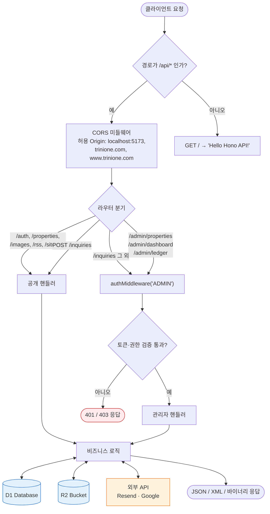

---

## 2. ADMIN 인증 미들웨어

`middlewares/auth.ts` — 관리자 API 전체에 적용됩니다.

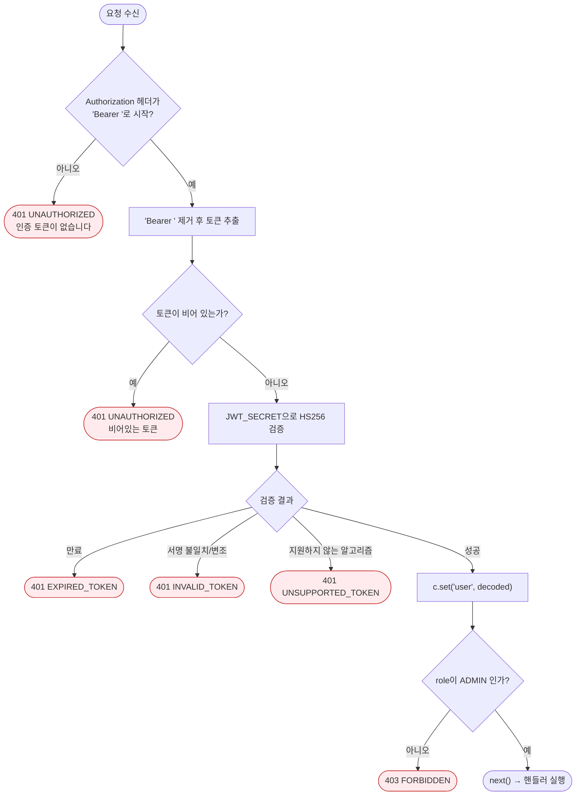

---

## 3. 인증 (Auth)

### 3.1 로그인 — `POST /auth/login`

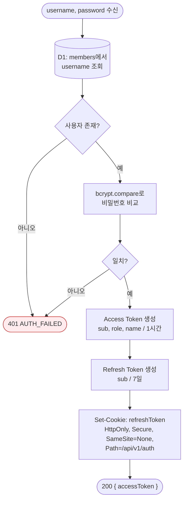

### 3.2 토큰 재발급 — `POST /auth/reissue`

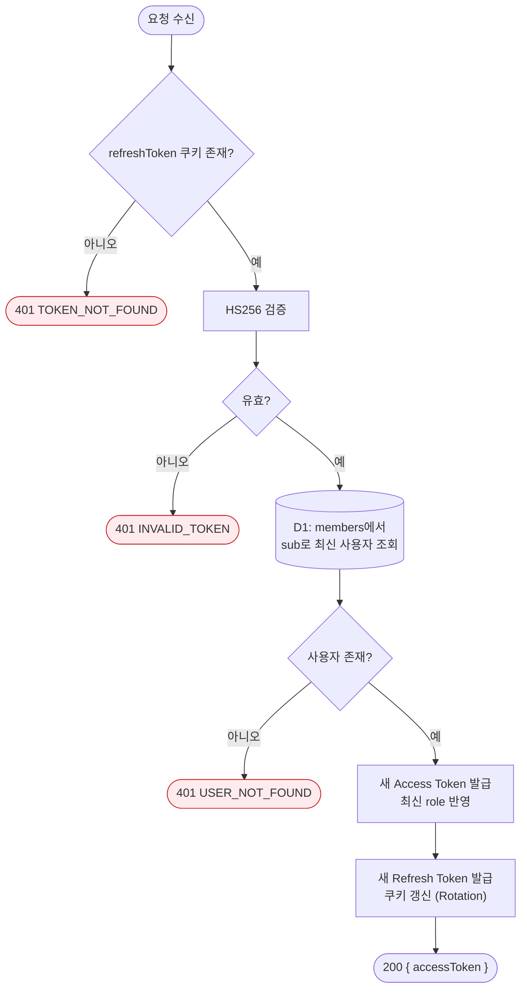

### 3.3 로그아웃 — `POST /auth/logout`


### 3.4 클라이언트 관점의 토큰 갱신 흐름

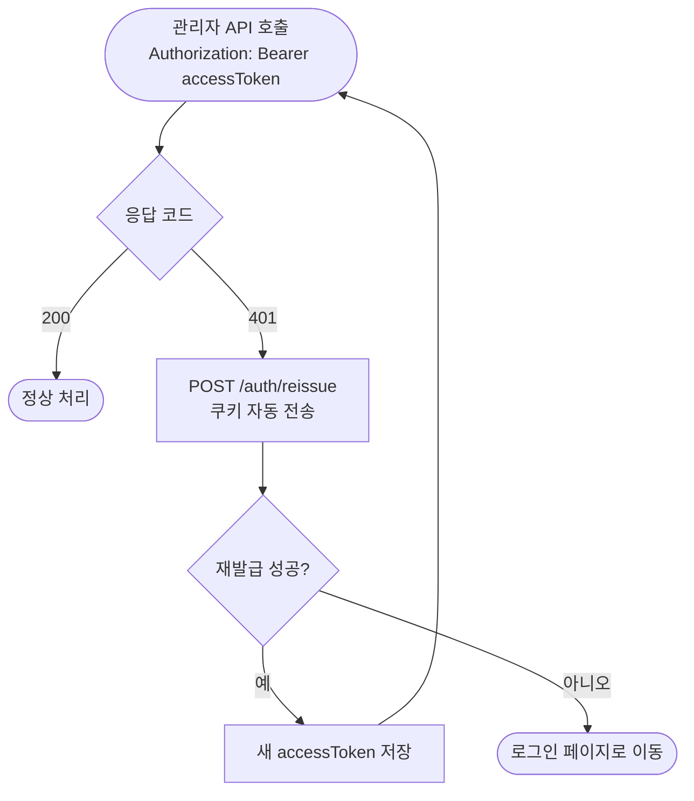

---

## 4. 매물 - 사용자용

### 4.1 매물 목록 — `GET /properties`

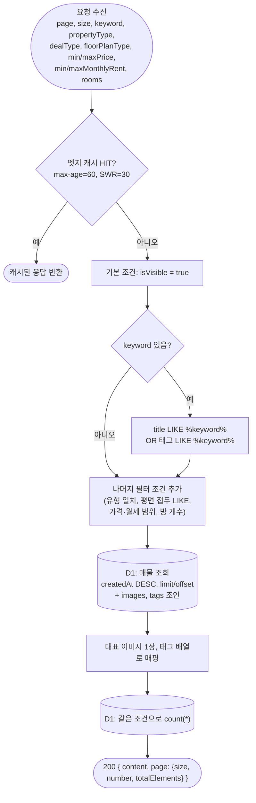

### 4.2 매물 상세 — `GET /properties/:id`

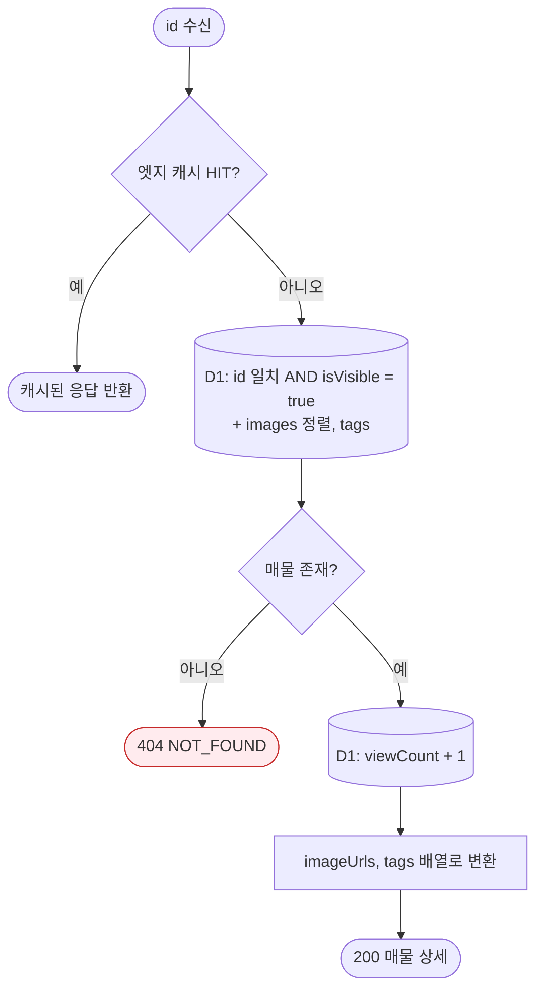

---

## 5. 상담 문의

### 5.1 문의 등록 — `POST /inquiries` (공개)

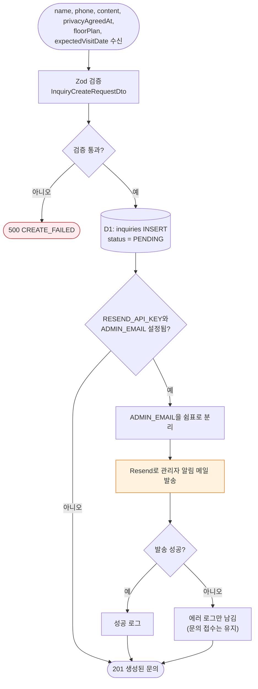

### 5.2 문의 관리 (ADMIN)

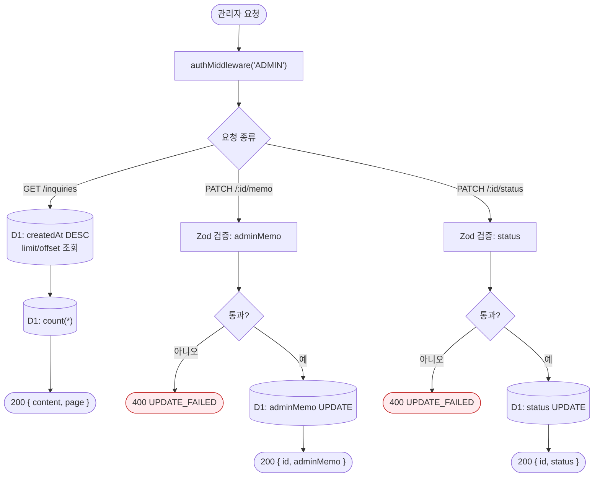

---

## 6. 매물 - 관리자용

모든 경로에 `authMiddleware('ADMIN')`가 적용됩니다. (아래 다이어그램에서는 생략)

### 6.1 매물 등록 — `POST /admin/properties` (multipart/form-data)

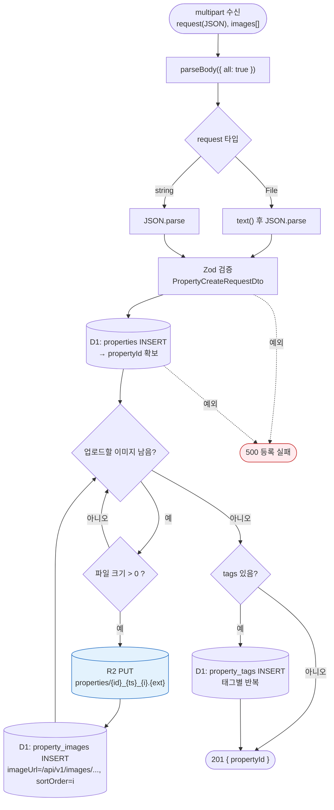

### 6.2 관리자 매물 목록 / 상세 — `GET /admin/properties`, `GET /admin/properties/:id`

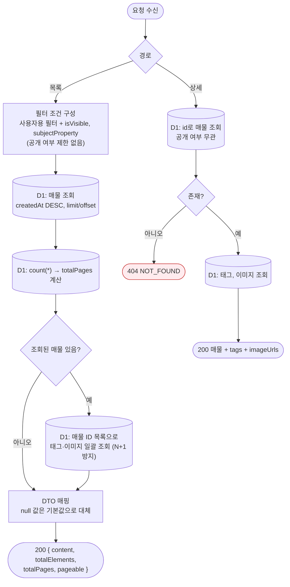

### 6.3 매물 수정 — `PUT /admin/properties/:id`

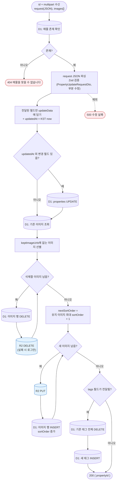

### 6.4 매물 삭제 — `DELETE /admin/properties/:id`

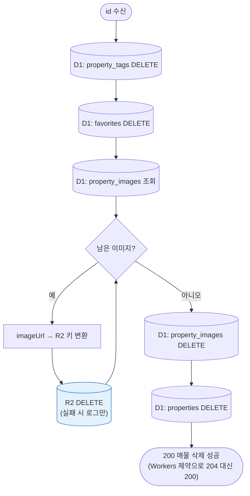

---

## 7. 관리자 대시보드

### 7.1 방문자 트래픽 — `GET /admin/dashboard/traffic`

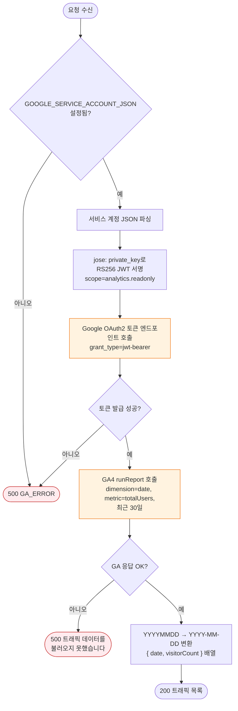

### 7.2 통계 — `GET /admin/dashboard/meta`

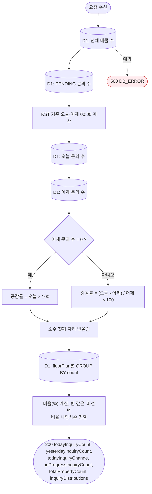

---

## 8. 원장 (Ledger)

모든 경로에 `authMiddleware('ADMIN')`가 적용되고, 응답에는 `Cache-Control: no-store`가 붙습니다.

### 8.1 전체 조회 — `GET /admin/ledger`

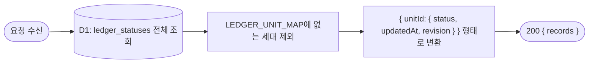

### 8.2 세대 상태 수정 — `PATCH /admin/ledger/:unitId` (낙관적 동시성 제어)

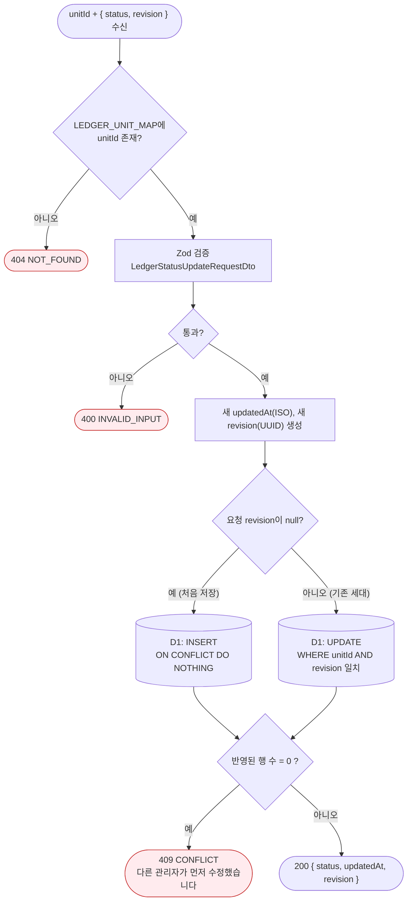

### 8.3 백업 일괄 복원 — `POST /admin/ledger/import`

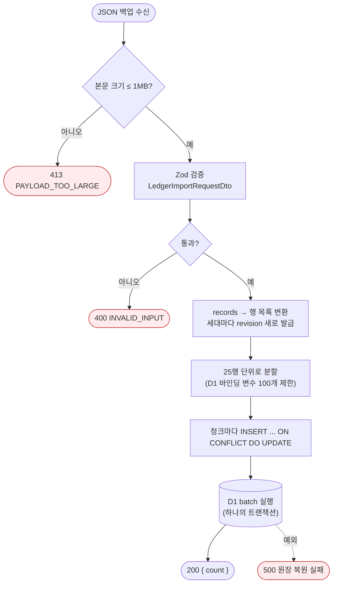

---

## 9. 이미지 · RSS · Sitemap

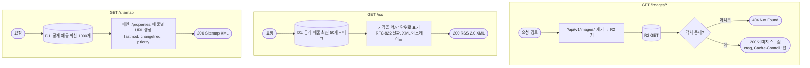

---

## 10. 업무 시나리오: 문의 접수부터 처리까지

방문자, 시스템(API), 관리자가 어떻게 이어지는지 보여주는 swimlane 형태의 활동 다이어그램입니다.

```mermaid
flowchart TD
    subgraph V["방문자"]
        V1(["사이트 접속"]) --> V2["매물 목록 탐색 / 필터 검색"]
        V2 --> V3["매물 상세 확인"]
        V3 --> V4["상담 문의 작성<br/>개인정보 동의"]
        V4 --> V5(["접수 완료 확인"])
    end

    subgraph S["시스템 (landing-hono)"]
        S1["GET /properties<br/>엣지 캐시 + D1"]
        S2["GET /properties/:id<br/>조회수 증가"]
        S3["POST /inquiries<br/>status = PENDING 저장"]
        S4["Resend로 관리자 메일 발송"]
        S5["토큰 발급 / 검증"]
        S6["문의 목록 · 통계 응답"]
        S7["상태 / 메모 저장"]
    end

    subgraph A["관리자"]
        A1["알림 메일 수신"] --> A2["POST /auth/login"]
        A2 --> A3["대시보드 확인<br/>GET /admin/dashboard/meta"]
        A3 --> A4["문의 목록 확인<br/>GET /inquiries"]
        A4 --> A5["고객 연락 후<br/>메모·상태 변경"]
        A5 --> A6(["처리 완료"])
    end

    V2 --> S1 --> V2
    V3 --> S2 --> V3
    V4 --> S3 --> V5
    S3 --> S4 --> A1
    A2 --> S5 --> A3
    A3 --> S6
    A4 --> S6
    A5 --> S7 --> A6
```
