# Bidket 활동 다이어그램 (API 분석 기반)

> 분석 대상: `Bidket/bidket-project/backend/` (Spring Cloud MSA)
> 다이어그램은 **현재 코드가 실제로 동작하는 방식**을 기준으로 그렸습니다. 설계 의도와 구현이 어긋나는 곳은 `⚠` 노드와 점선으로 표시했고, 문서 끝 [구현 갭](#10-구현-갭-정리)에 따로 모았습니다.

## 서비스 개요

| 서비스 | 포트 | 역할 |
|---|---|---|
| gateway-service | 8000 | 라우팅, JWT → `X-User-Id`/`X-User-Role` 헤더 주입, 대기열 토큰 필터 |
| eureka-server | - | 서비스 디스커버리 |
| user-service | 8100 | 회원, 인증(JWT), 블랙리스트, 포인트 |
| product-service | 8200 | 상품, 브랜드, 카테고리, SKU (관리자 등록) |
| auction-service | 8300 | 경매, 입찰, 경매 종료 Saga, 결제 타임아웃 Saga |
| queue-service | 8400 | 경매 대기열(Redis ZSET), 활성 토큰 발급 (WebFlux) |
| order-service | 8500 | 주문, 결제, 환불, 결제 기한 스케줄러 |
| notification-service | 8600 | Kafka 이벤트 알림(IN_APP/EMAIL), Slack |

### 주요 API 요약

| 서비스 | 엔드포인트 |
|---|---|
| user | `POST /v1/members/signup·login·social-login·token/refresh·logout`, `GET/PATCH/DELETE /v1/members/me·profile·password`, `GET /v1/members/check-email·check-nickname·bid-eligibility·points·points/history`, `POST/DELETE /v1/members/{id}/blacklist`, `GET /api/v1/users/{id}/email` (내부) |
| product | `GET /v1/products`, `/v1/products/{id}`, `/v1/products/{id}/page`, `/v1/products/search`, `/v1/products/skus`, `/v1/brands`, `/v1/categories(/tree)`, `POST /v1/admin/{product-types, brands, categories, size-types, sizes, products, products/with-shoes, products/{id}/skus ...}` |
| auction | `POST/GET /api/v1/auctions`, `GET/PUT/DELETE /api/v1/auctions/{id}`, `POST /api/v1/auctions/{id}/confirm`, `GET /api/v1/auctions/seller/{sellerId}` |
| auction (bid) | `POST /api/v1/bids`, `POST /api/v1/bids/auction/{auctionId}/buy-now`, `GET /api/v1/bids/auction/{auctionId}·my·{bidId}`, `DELETE /api/v1/bids/{bidId}` |
| queue | `POST/DELETE/GET /v1/queues/{auctionId}`, `GET /v1/queues/{auctionId}/status`, `POST /v1/queues/{auctionId}/heartbeat`, `PATCH /v1/admin/queues/{id}`, `GET /v1/admin/queues/{id}/metrics`, `POST/DELETE /v1/internal/queues` |
| order | `POST/GET /v1/orders`, `POST /v1/payments`, `POST /v1/payments/confirm`, `PATCH /v1/payments/fail`, `GET /v1/payments`, `POST /v1/refunds/{paymentId}`, `GET /v1/refunds` |
| notification | `POST /api/v1/notifications/send`, `PATCH /api/v1/notifications/{id}/read`, `DELETE /api/v1/notifications/{id}` |

### 전체 흐름 한눈에 보기

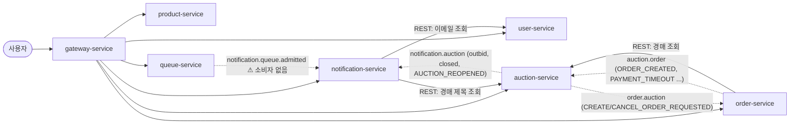

---

## 1. Gateway 요청 처리

필터 순서: Security(전부 permitAll) → `RequestHeaderFilter`(-2) → `ResponseHeaderFilter`(-1) → (bid 라우트만) `QueueActiveTokenFilter`

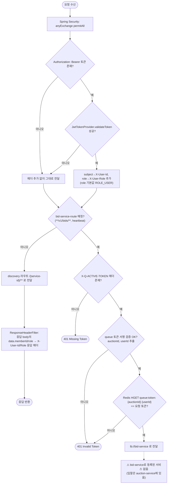

---

## 2. 인증 (user-service)

### 2-1. 회원가입 `POST /v1/members/signup`

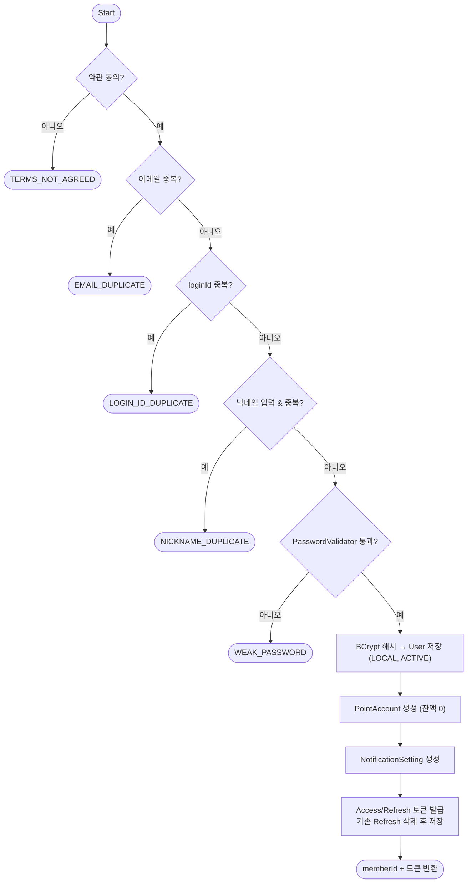

### 2-2. 로그인 / 소셜 로그인

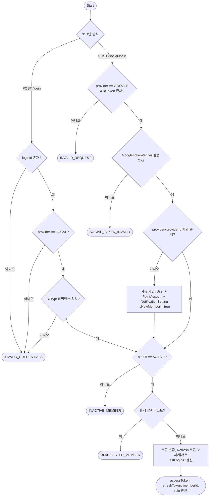

### 2-3. 토큰 재발급 / 로그아웃

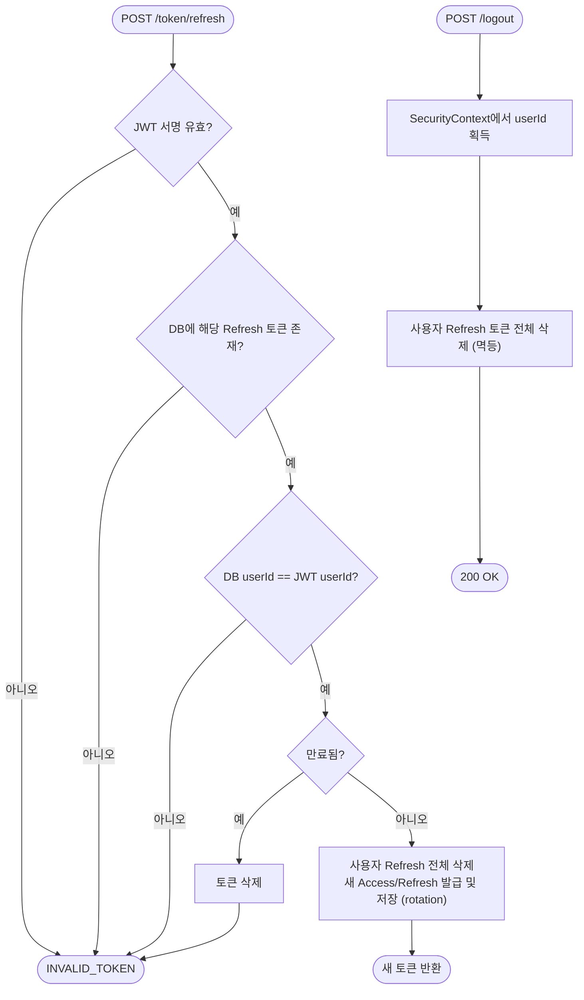

---

## 3. 대기열 (queue-service)

### 3-1. 대기열 설정 생성

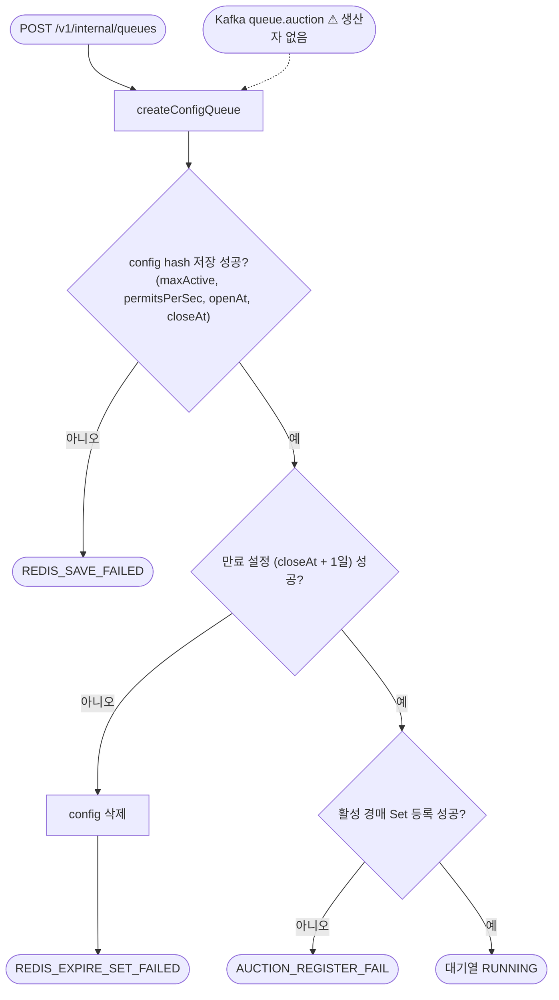

### 3-2. 입장 → 대기 → 활성 토큰 발급

모든 트래픽 API는 `@CheckQueueConfig`(config 존재, openAt ≤ now ≤ closeAt)를 먼저 통과해야 합니다.

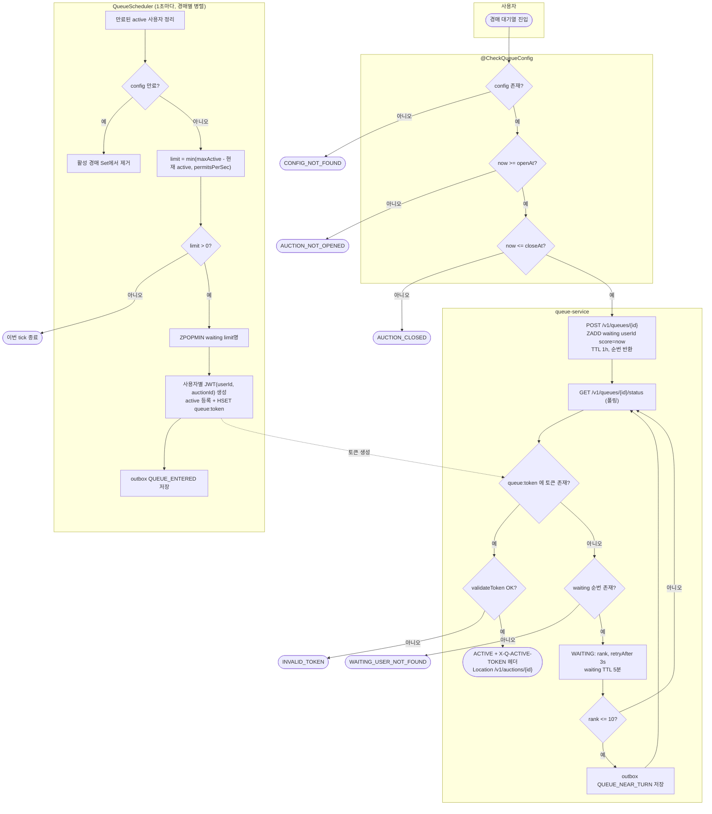

### 3-3. Heartbeat / 취소 / Outbox 발행

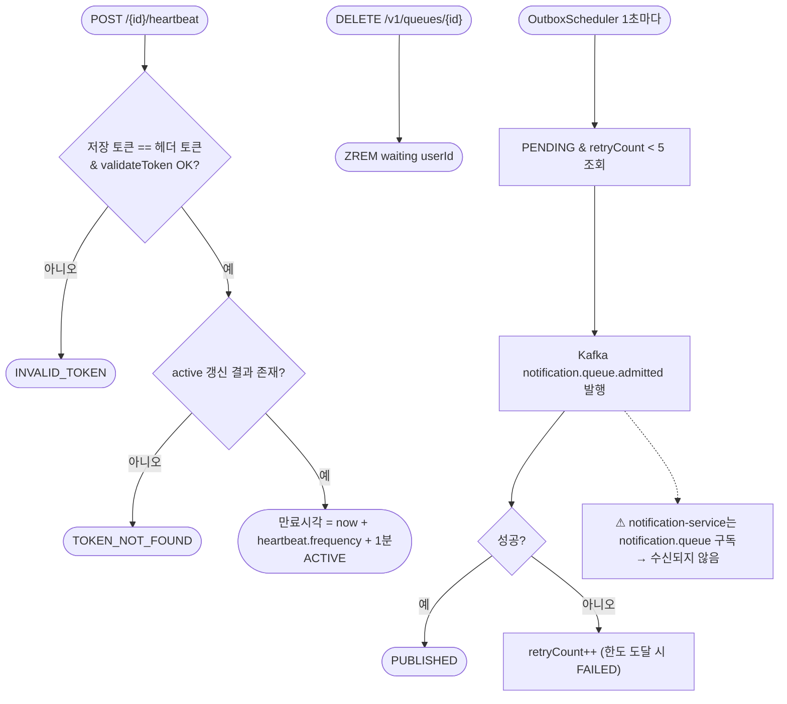

---

## 4. 경매 생성 · 시작 · 종료 (auction-service)

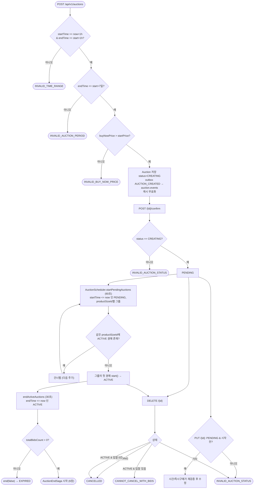

---

## 5. 입찰 / 즉시구매 (auction-service `BidService`)

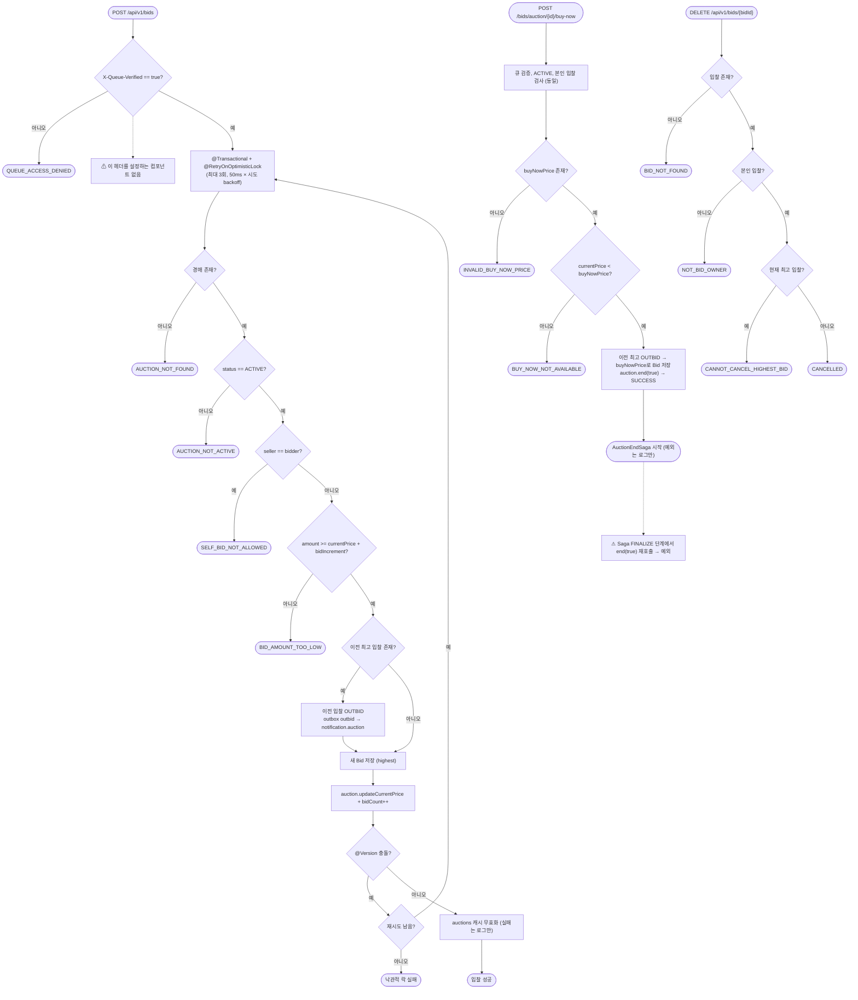

> 입찰 경로에는 user-service 입찰 자격(`/bid-eligibility`) 확인, 포인트 잔액 확인, Redis 분산락(`RedisLockService`) 호출이 **없습니다.** 동시성은 낙관적 락과 재시도로만 처리합니다.

---

## 6. 경매 종료 Saga (`AuctionEndSagaOrchestrator`)

단계: `CREATE_ORDER → MARK_WINNING_BID → FINALIZE_AUCTION → PUBLISH_END_EVENT`
(Bulkhead `sagaOrchestrator`, CircuitBreaker `orderService`, Retry `sagaStep`)

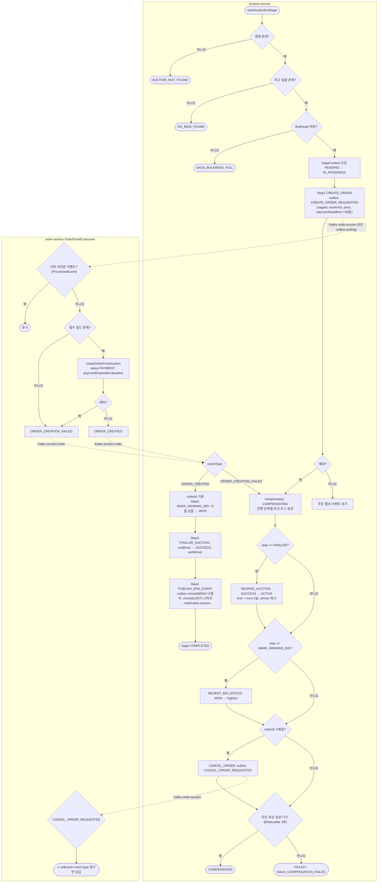

### Saga 복구 (`SagaRecoveryService`, ApplicationReadyEvent)

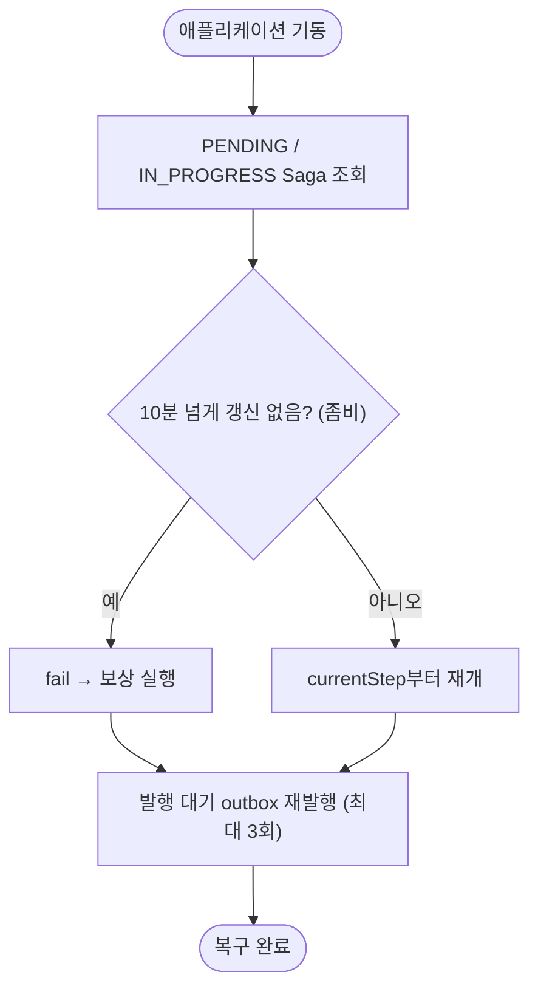

---

## 7. 결제 타임아웃 Saga

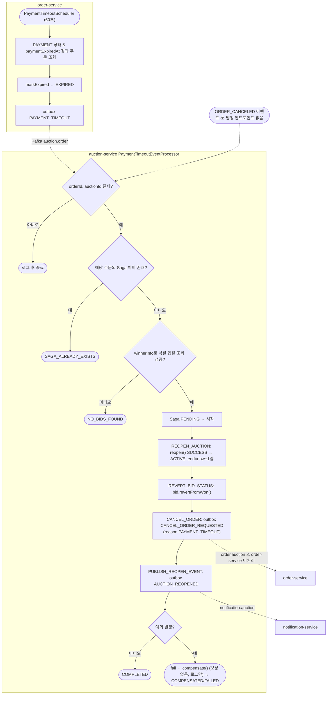

---

## 8. 주문 / 결제 / 환불 (order-service)

```mermaid
flowchart TD
    subgraph Pay["POST /v1/payments?userId="]
        S([결제 요청]) --> A{"주문 존재?"}
        A -- 아니오 --> E1([오류: 주문 없음])
        A -- 예 --> B{"주문 소유자 == userId?"}
        B -- 아니오 --> E2([오류: 소유자 불일치])
        B -- 예 --> C{"결제 기한 경과?"}
        C -- 예 --> CX["주문 EXPIRED 처리 (이벤트 없음)"] --> E3([오류: 만료])
        C -- 아니오 --> D{"주문 status == PAYMENT?"}
        D -- 아니오 --> E4([오류: 결제 불가 상태])
        D -- 예 --> F{"금액 == 주문 금액?"}
        F -- 아니오 --> E5([오류: 금액 불일치])
        F -- 예 --> G{"PENDING 결제 이미 존재?"}
        G -- 예 --> E6([오류: 중복 결제])
        G -- 아니오 --> H["Payment.create → 즉시 approve() (PG 미연동)<br/>Payment SUCCESS"]
        H --> I["주문 → PAID<br/>outbox PAYMENT_COMPLETED → auction.order"]
        I --> OK([결제 완료])
    end

    subgraph Confirm["POST /v1/payments/confirm, PATCH /v1/payments/fail"]
        CF([confirm]) --> CF1{"paymentKey 존재 & 주문·금액 검증 OK<br/>& Payment PENDING?"}
        CF1 -- 아니오 --> CFE([오류])
        CF1 -- 예 --> CF2(["Payment SUCCESS, 주문 PAID (이벤트 없음)"])
        FL([fail]) --> FL1{"주문 검증 OK & Payment PENDING?"}
        FL1 -- 아니오 --> FLE([오류])
        FL1 -- 예 --> FL2(["Payment FAILED, 주문 CANCELED (이벤트 없음)"])
    end

    subgraph Refund["POST /v1/refunds/{paymentId}"]
        R([환불 요청]) --> R1{"진행 중/완료된 환불 존재?"}
        R1 -- 예 --> RE([오류])
        R1 -- 아니오 --> R2{"결제 소유자 일치 & Payment SUCCESS<br/>& 금액 전액 & 주문 PAID?"}
        R2 -- 아니오 --> RE
        R2 -- 예 --> R3["Refund REQUESTED<br/>Payment, 주문 → REFUND_REQUESTED"]
        R3 -.-> R4["⚠ approveRefund(→ REFUNDED)는 호출 엔드포인트 없음"]
    end
```

**상태 전이**
- 주문: `PAYMENT → PAID | CANCELED | EXPIRED`, `PAID → REFUND_REQUESTED → REFUNDED`
- 결제: `PENDING → SUCCESS | FAILED`, `SUCCESS → REFUND_REQUESTED → REFUNDED`

---

## 9. 알림 처리 (notification-service)

```mermaid
flowchart TD
    subgraph Kafka["Kafka Consumer (notification.queue / auction / order)"]
        S([이벤트 수신, userId=record key]) --> A{"payload 존재 & eventType 존재?"}
        A -- 아니오 --> EA([에러 처리 → DLT])
        A -- 예 --> B{"eventId, userId, eventType 유효?"}
        B -- 아니오 --> EB(["IllegalArgumentException → 재시도"])
        B -- 예 --> C{"토픽 prefix로 카테고리 결정<br/>QUEUE / AUCTION / ORDER?"}
        C -- 알 수 없음 --> EB
        C -- 예 --> D{"eventType"}
        D -- "near_turn / admitted / outbid" --> IN["채널: IN_APP"]
        D -- "closed (result WON/LOST)" --> IN
        D -- "payment_required / paid" --> IE["채널: IN_APP + EMAIL"]
        IN --> EN["auction-service에서 경매 제목 조회 (REST)"]
        IE --> EN
        EN --> SS{"eventId + channel 이미 처리?"}
        SS -- 예 --> SKIP([건너뜀])
        SS -- 아니오 --> CH{"채널 == EMAIL?"}
        CH -- 예 --> EM1["user-service에서 이메일 조회<br/>GET /api/v1/users/{id}/email"]
        EM1 --> EM2{"JavaMailSender 발송 성공?"}
        EM2 -- 아니오 --> EMF(["markAsFailed → 예외 (재시도)"])
        EM2 -- 예 --> SAVE
        CH -- 아니오 --> SAVE["Notification 저장"]
        SAVE --> ACK([수동 ACK])
    end

    subgraph Rest["POST /api/v1/notifications/send"]
        R([REST 요청]) --> R1{"type"}
        R1 -- SLACK --> RS["SlackSender 웹훅 POST<br/>(userId 기본값: 시스템 UUID)"]
        R1 -- EMAIL --> RE{"target & userId 존재?"}
        R1 -- IN_APP --> RI{"userId 존재?"}
        R1 -- 기타 --> RX(["INVALID_NOTIFICATION_TYPE"])
        RE -- 예 --> RSEND["발송"]
        RI -- 예 --> RSEND
        RS --> RR
        RSEND --> RR(["저장 후 SENT / FAILED 표시"])
    end

    subgraph Manage["읽음 / 삭제"]
        M([PATCH read, DELETE]) --> M1{"채널 == IN_APP?"}
        M1 -- 아니오 --> ME1(["NOTIFICATION_CHANNEL_NOT_SUPPORTED"])
        M1 -- 예 --> M2{"소유자?"}
        M2 -- 아니오 --> ME2(["FORBIDDEN"])
        M2 -- 예 --> M3(["읽음 처리 / soft delete (이미 삭제됐으면 NOT_FOUND)"])
    end
```

---

## 10. 구현 갭 정리

| # | 위치 | 내용 | 영향 |
|---|---|---|---|
| 1 | gateway `application.yml` | `bid-service-route`가 `lb://bid-service`를 가리키지만 그런 서비스가 없음 (입찰은 auction-service) | 대기열 토큰 필터를 거치는 입찰 경로가 동작하지 않음 |
| 2 | gateway ↔ auction | `X-Queue-Verified` 헤더를 설정하는 곳이 없음 | `createBid`/`buyNow`가 항상 `QUEUE_ACCESS_DENIED` |
| 3 | queue `TokenProvider` ↔ gateway `QueueTokenProvider` | 시크릿 디코딩 방식이 다름 (BASE64URL vs UTF-8 bytes) | 활성 토큰 서명 검증 실패 가능 |
| 4 | auction `BidService` | 입찰 자격·포인트 확인과 분산락 호출이 없음 (`RedisLockService` 미사용) | 블랙리스트 회원도 입찰 가능 |
| 5 | auction Saga | 즉시구매 후 Saga FINALIZE 단계에서 `end(true)`를 다시 호출 | 즉시구매 Saga 실패 |
| 6 | order `OrderEventConsumer` | `CANCEL_ORDER_REQUESTED`를 처리하지 않음 | 보상·타임아웃 취소가 주문에 반영되지 않음 |
| 7 | order | `cancelOrder`, `approveRefund`를 호출하는 엔드포인트 없음 | ORDER_CANCELED 이벤트 없음, 환불 완료 불가 |
| 8 | Kafka payload | order envelope의 `payload.data` 구조와 auction 파싱 위치가 다르고, CREATE_ORDER_REQUESTED의 userId 위치도 다름 | ORDER_CREATION_FAILED 발생 가능 |
| 9 | queue → notification | `notification.queue.admitted`로 발행하지만 `notification.queue`를 구독. 이벤트 타입명도 다름 (`QUEUE_ENTERED` vs `admitted`) | 대기열 알림 미전달 |
| 10 | notification | `notification.order`, `payment_required`/`paid` 생산자가 없음. auction outbox envelope 형식도 `EventTemplate`과 다름 | 결제 관련 이메일 알림 미동작 |
| 11 | user-service | 블랙리스트 등록·해제에 역할 검사가 없음 | 일반 사용자도 호출 가능 |
