# ECLIPSE (의류 쇼핑몰) API 활동 다이어그램

> 분석 대상: `Eclipse/src/main/java/com/example/shop_project` (Spring Boot)
> 구성: MySQL(JPA), Redis(상품 조회수), JWT(쿠키: `accessToken` / `refreshToken`), Google OAuth2, PortOne(아임포트) 결제, STOMP WebSocket(상담 채팅), 로컬 파일 저장소(`C:/webserver_storage/`)

## 목차
- [API 엔드포인트 요약](#api-엔드포인트-요약)
- [0. 공통 요청 처리 흐름 (JwtFilter + 인가)](#0-공통-요청-처리-흐름-jwtfilter--인가)
- [1. 회원가입 (일반 / Google OAuth2)](#1-회원가입-일반--google-oauth2)
- [2. 로그인 / 토큰 재발급 / 로그아웃](#2-로그인--토큰-재발급--로그아웃)
- [3. 회원 정보 관리 (중복확인, 정보수정, 비밀번호 재설정, 탈퇴)](#3-회원-정보-관리)
- [4. 상품 (등록 / 수정 / 삭제 / 조회수)](#4-상품)
- [5. 카테고리 (관리자)](#5-카테고리-관리자)
- [6. 주문 + 결제 (Checkout)](#6-주문--결제-checkout)
- [7. 주문 취소 · 환불 · 배송상태 관리](#7-주문-취소--환불--배송상태-관리)
- [8. 포인트 · 멤버십](#8-포인트--멤버십)
- [9. 찜 · 리뷰 · 문의/답글](#9-찜--리뷰--문의답글)
- [10. 챗봇 · 상담원 채팅](#10-챗봇--상담원-채팅)

---

## API 엔드포인트 요약

| 도메인 | Method | URL | 설명 | Controller |
|---|---|---|---|---|
| 인증 | POST | `/jwt-login` | 이메일/비밀번호 로그인, 토큰 쿠키 발급 | `jwt/controller/JwtController` |
| 인증 | POST | `/jwt-refresh` | refreshToken으로 accessToken 재발급 | 〃 |
| 인증 | POST | `/jwt-logout` | 토큰 쿠키 삭제 | 〃 |
| 인증 | POST | `/logout` | Spring Security 로그아웃 | `security/CustomLogoutSuccessHandler` |
| 인증 | GET | `/oauth2/authorization/google` | 구글 로그인 | `security/CustomAuthenticationSuccessHandler` |
| 회원 | POST | `/join` | 일반 회원가입 (+ 포인트 계정 생성) | `member/controller/MemberViewController` |
| 회원 | GET / POST | `/signup/confirm`, `/signup/extra` | OAuth2 신규회원 추가정보 입력 | `oauth2/ExtraSignupViewController` |
| 회원 | GET | `/api/v1/members/check-email` | 이메일 중복 (중복 시 409) | `member/controller/MemberAPIController` |
| 회원 | GET | `/api/v1/members/check-nickname` | 닉네임 중복 (중복 시 409) | 〃 |
| 회원 | POST | `/api/v1/members/verify-password` | 현재 비밀번호 확인 (불일치 401) | 〃 |
| 회원 | POST | `/mypage/edit` | 회원 정보 수정 | `MemberViewController` |
| 회원 | POST | `/mypage/withdraw` | 회원 탈퇴 (soft delete) | 〃 |
| 회원 | POST | `/password-reset` | 임시 비밀번호 발급 | 〃 |
| 상품 | POST | `/api/products` | 상품 등록 (multipart) | `product/controller/ProductAPIController` |
| 상품 | PATCH | `/api/products/{productId}` | 상품 부분 수정 | 〃 |
| 상품 | DELETE | `/api/products/{productId}` | 상품 삭제 | 〃 |
| 상품 | GET | `/api/products/available-sizes` | 색상별 재고 있는 사이즈 | 〃 |
| 상품 | POST | `/products/detail/{productId}/confirm-view` | Redis 조회수 DB 반영 | `product/controller/productViewController` |
| 상품 | GET | `/products/edit/{productId}/images` | 상품 이미지 URL 목록 | 〃 |
| 상품 | GET | `/upload/products/{filename}` | 이미지 파일 서빙 | `product/controller/ImageController` |
| 카테고리 | GET | `/api/v1/categories/categoryList`, `/list`, `/main`, `/{mainId}/sub` | 카테고리 조회 | `category/controller/CategoryAPIController` |
| 카테고리 | POST | `/api/v1/categories/create` | 메인/서브 카테고리 추가 | 〃 |
| 카테고리 | PATCH | `/api/v1/categories/update` | 카테고리 수정 | 〃 |
| 카테고리 | DELETE | `/api/v1/categories/delete` | 카테고리 삭제 | 〃 |
| 주문 | POST | `/api/v1/orders/create` | 주문 생성 | `order/controller/OrderAPIController` |
| 주문 | GET | `/api/v1/orders/{orderNo}`, `/{orderNo}/order-detail` | 주문/주문상세 조회 | 〃 |
| 주문 | PATCH | `/api/v1/orders/{orderNo}/update-status` | 주문 상태 변경 | 〃 |
| 주문 | DELETE | `/api/v1/orders/{orderNo}/delete` | 주문 삭제 | 〃 |
| 주문 | GET | `/api/v1/orders/member-info` | 주문자 정보 | 〃 |
| 주문 | GET | `/api/v1/orders/recent-order-no` | 최근 주문번호 | 〃 |
| 주문 | POST | `/api/v1/orders/{orderNo}/canceled-order` | 취소/환불 요청 | 〃 |
| 주문 | DELETE | `/api/v1/orders/canceled-order` | 취소 요청 철회 | 〃 |
| 주문 | PATCH | `/api/v1/orders/address` | 배송지 변경 | 〃 |
| 주문 | GET | `/api/v1/orders/product-option/{productId}`, `/product-image` | 장바구니용 상품 정보 | 〃 |
| 주문 | POST | `/api/v1/orders/{orderNo}/payment-fail` | 결제 이탈 시 FAIL 처리 | 〃 |
| 결제 | POST | `/api/v1/payments/create` | 결제 정보 저장 + 판매량 증가 | `order/controller/PaymentAPIController` |
| 결제 | PATCH | `/api/v1/payments/decrease-product-stock` | 재고 차감 (부족 시 307) | 〃 |
| 결제 | PATCH | `/api/v1/payments/restore-product-stock` | 재고 복구 | 〃 |
| 포인트 | GET | `/api/v1/points` | 내 포인트 | `point/controller/PointAPIController` |
| 포인트 | POST | `/api/v1/points/save-point`, `/use-point` | 포인트 적립 / 사용 | 〃 |
| 찜 | POST / DELETE | `/api/favorites/{productId}` | 찜 추가 / 해제 | `favorite/controller/FavoriteAPIController` |
| 리뷰 | POST | `/review/create` | 리뷰 작성 (+500P) | `review/controller/ReviewViewController` |
| 문의 | POST | `/products/{productId}/inquiries` | 문의 작성 | `inquiry/controller/InquiryViewController` |
| 문의 | DELETE | `/api/v1/products/{productId}/inquiries/{inquiryId}` | 문의 삭제 | `inquiry/controller/InquiryAPIController` |
| 답글 | POST / DELETE | `/products/{pId}/inquiries/{iId}/comment[/{commentId}]` | 관리자 답글 작성 / 삭제 | `comment/controller/CommentController` |
| 관리자 | PUT | `/api/v1/admin/members/role/{id}` | 회원 권한 변경 | `admin/controller/AdminMemberAPIController` |
| 관리자 | PUT | `/api/v1/admin/members/withdraw/{id}` | 회원 탈퇴 처리 | 〃 |
| 관리자 | PATCH | `/api/v1/admin/orders/{orderNo}/update-status` | 배송 상태 변경 | `admin/controller/AdminOrderAPIController` |
| 관리자 | PATCH | `/api/v1/admin/orders/refund?orderNo=` | 환불 승인 | 〃 |
| 관리자 | DELETE / GET | `/api/v1/admin/orders/{orderNo}[/delete]` | 주문 삭제 / 상세 | 〃 |
| 관리자 | DELETE | `/api/v1/admin/points/savedpoint`, `/usedpoint` | 포인트 적립/사용 취소 | `admin/controller/AdminPointAPIController` |
| 챗봇 | POST | `/api/v1/chatbot?message=` | FAQ 챗봇 응답 | `chatbot/controller/ChatbotAPIController` |
| 채팅 | POST | `/api/v1/chat/connection` | 상담 채팅방 생성 (WAITING) | `chatbot/controller/ChatRoomAPIController` |
| 채팅 | GET | `/api/v1/chat/room-status?roomId=` | 방 상태 폴링 | 〃 |
| 채팅 | GET / POST | `/api/v1/chat/admin/assign`, `/end` | 상담원 배정 / 상담 종료 | `chatbot/controller/AdminChatAPIController` |
| 채팅 | STOMP | `/chat/send` → `/topic/messages`, `/chat/end` → `/topic/chat/end` | 실시간 메시지 / 종료 이벤트 | `chatbot/controller/ChatMessageController` |

---

## 0. 공통 요청 처리 흐름 (JwtFilter + 인가)

`jwt/JwtFilter.java`, `jwt/JwtProviderImpl.java`, `security/SecurityConfig.java`

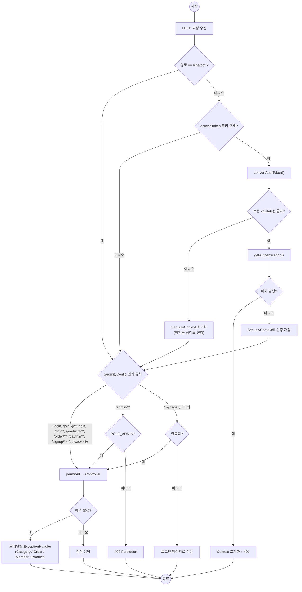

---

## 1. 회원가입 (일반 / Google OAuth2)

`member/controller/MemberViewController.java`, `member/service/MemberService.java`, `security/CustomAuthenticationSuccessHandler.java`, `oauth2/ExtraSignupViewController.java`, `point/service/PointService.java`

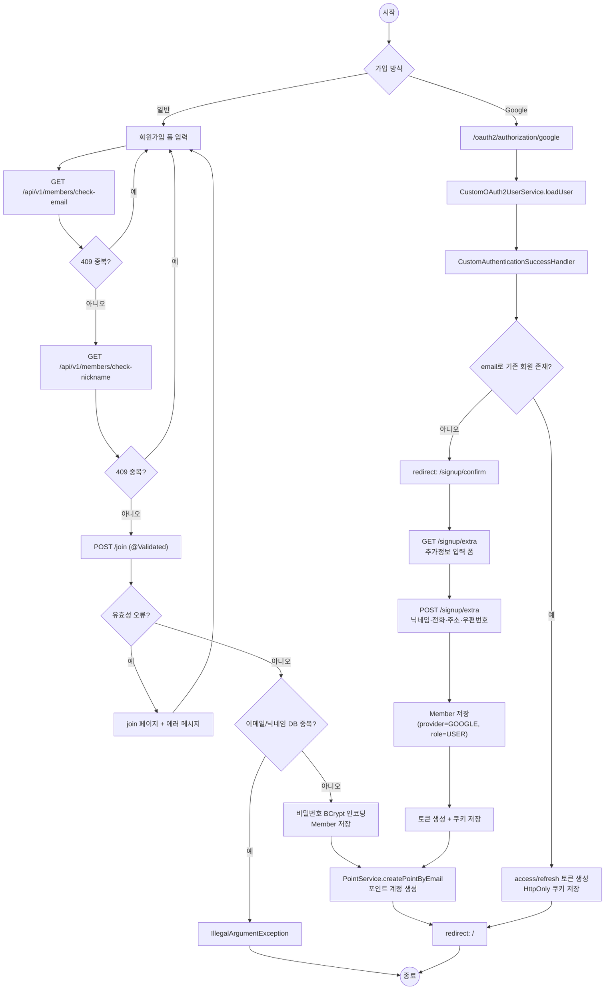

---

## 2. 로그인 / 토큰 재발급 / 로그아웃

`jwt/controller/JwtController.java`, `member/service/MemberService#login`, `security/CustomLogoutSuccessHandler.java`

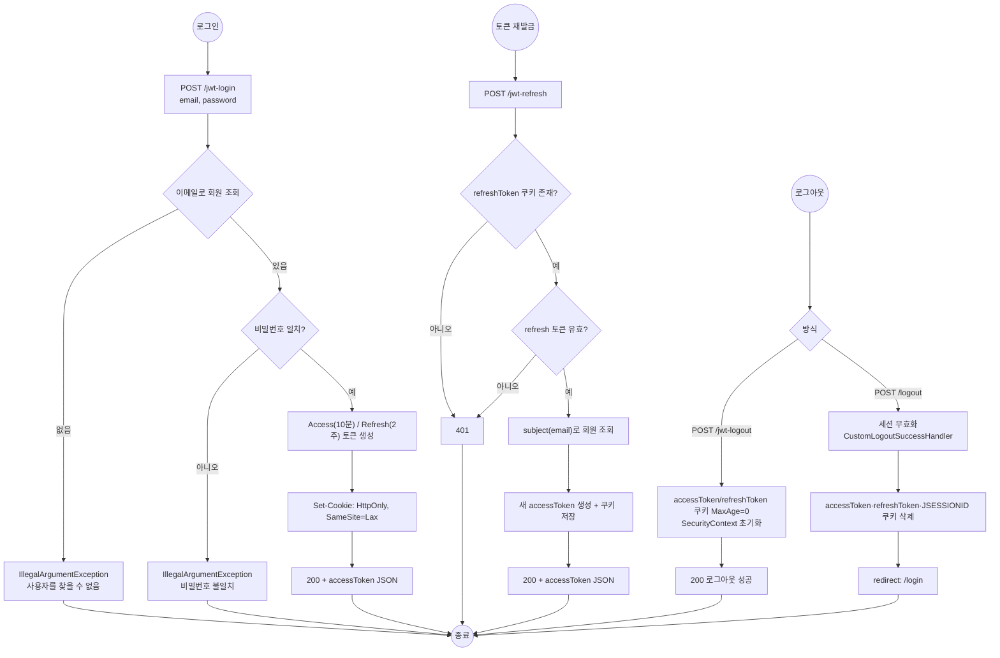

---

## 3. 회원 정보 관리

`MemberAPIController`, `MemberViewController`, `member/service/MemberCleanupService.java`, `admin/controller/AdminMemberAPIController.java`

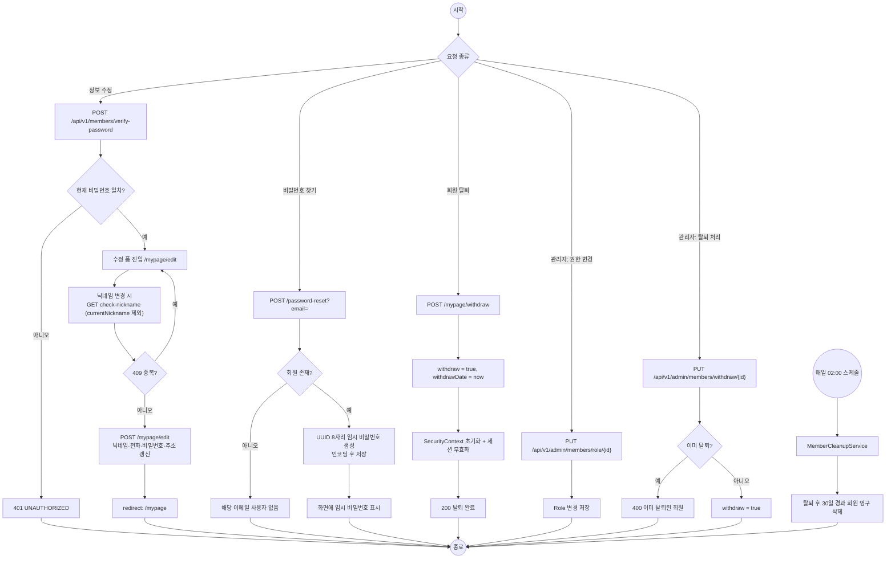

---

## 4. 상품

`product/controller/ProductAPIController.java`, `product/controller/productViewController.java`, `product/service/ProductService.java`, `product/service/ImageService.java`

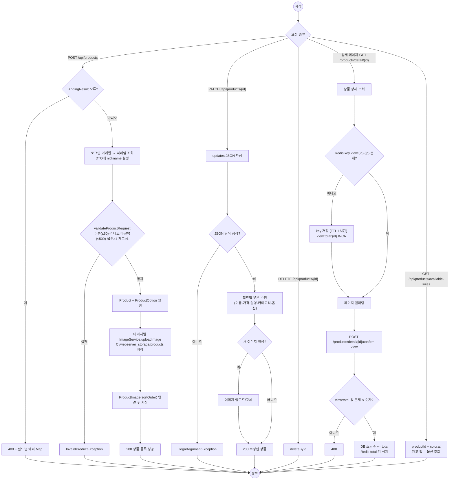

---

## 5. 카테고리 (관리자)

`category/controller/CategoryAPIController.java`, `category/service/CategoryService.java`, `category/exception/*`

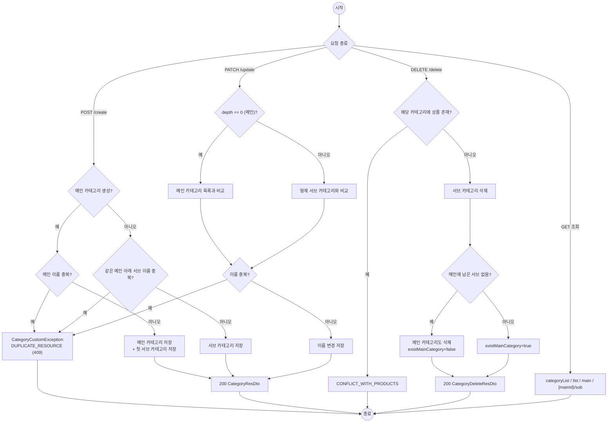

---

## 6. 주문 + 결제 (Checkout)

`static/order/js/checkout.js` (클라이언트 오케스트레이션), `OrderAPIController`, `PaymentAPIController`, `order/service/OrderService.java`, `order/service/PaymentService.java`, `PointAPIController`

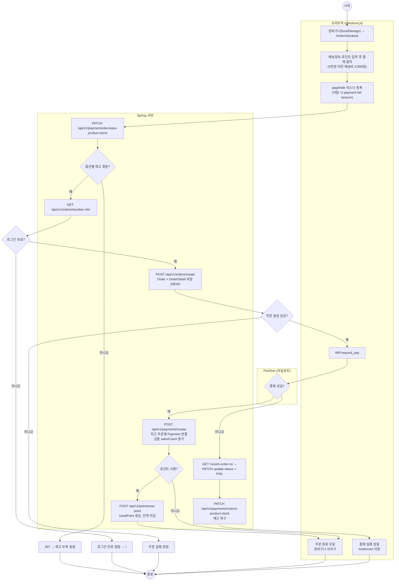

---

## 7. 주문 취소 · 환불 · 배송상태 관리

`OrderAPIController`, `OrderViewController`, `admin/controller/AdminOrderAPIController.java`, `OrderService#refund`, `PaymentService#cancelPay`

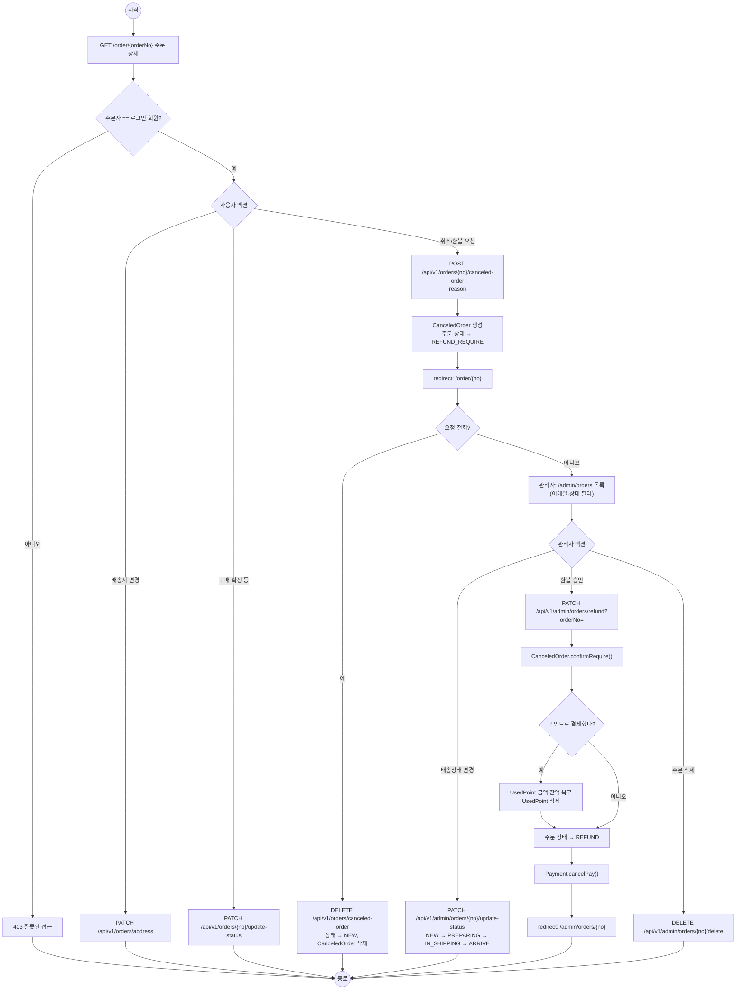

---

## 8. 포인트 · 멤버십

`point/controller/PointAPIController.java`, `point/service/PointService.java`, `point/entity/Point.java`, `admin/controller/AdminPointAPIController.java`

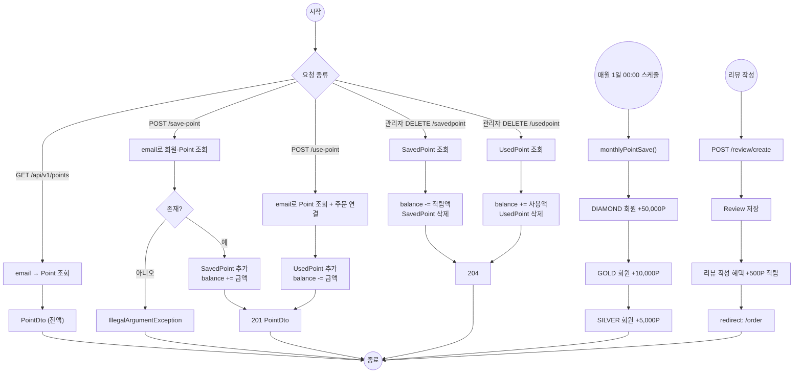

---

## 9. 찜 · 리뷰 · 문의/답글

`favorite/*`, `review/*`, `inquiry/*`, `comment/*`

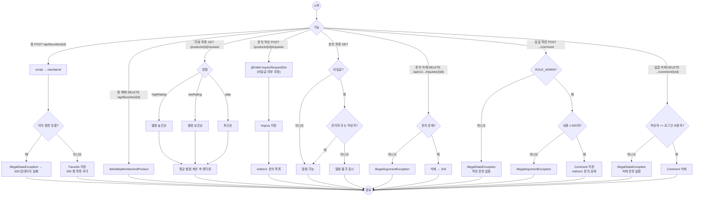

---

## 10. 챗봇 · 상담원 채팅

`chatbot/controller/*`, `chatbot/service/ChatbotService.java`, `chatbot/service/ChatService.java` (채팅방은 메모리 `ConcurrentHashMap`에 보관)

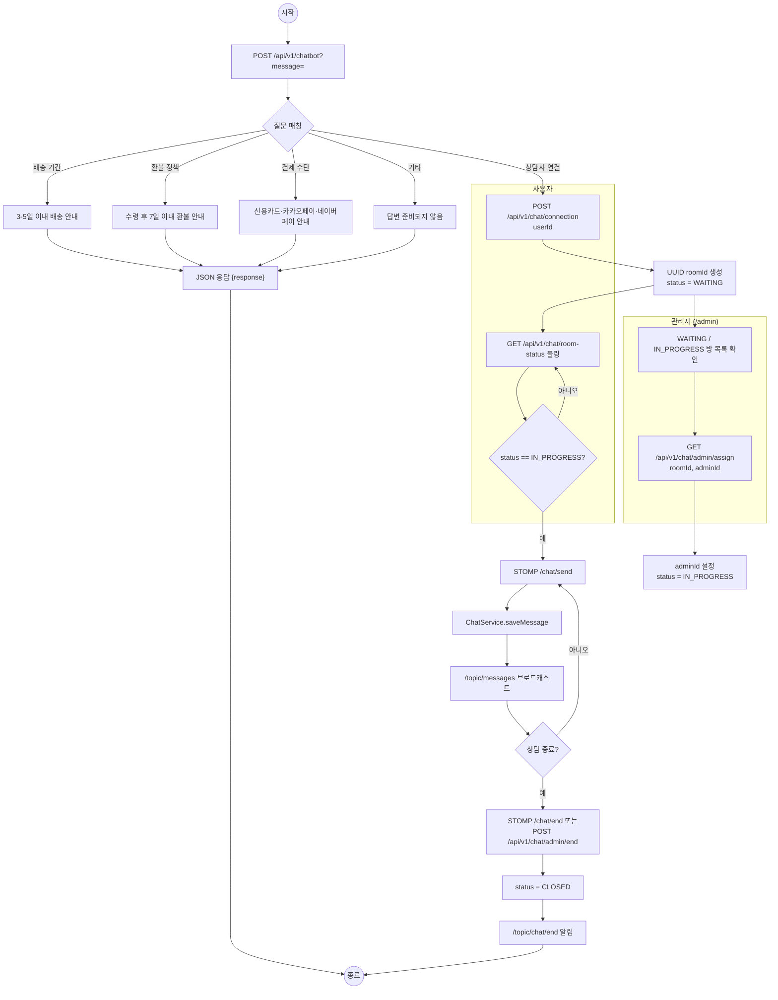
