# 우리동네병원 (UriDongneHostpital) API 활동 다이어그램

> 분석 대상: `UriDongneHostpital/src/main/java/com/example/elice_3rd` (Spring Boot)
> 저장소: MySQL(JPA), MongoDB(채팅 메시지), Redis(Refresh Token / 인증코드), Kafka(채팅·알림), SMTP(메일), SSE(실시간 알림), STOMP WebSocket(채팅)

## 목차
- [API 엔드포인트 요약](#api-엔드포인트-요약)
- [0. 공통 요청 처리 흐름 (JWT 필터)](#0-공통-요청-처리-흐름-jwt-필터)
- [1. 회원가입 + 이메일 인증](#1-회원가입--이메일-인증)
- [2. 로그인 / 로그아웃](#2-로그인--로그아웃)
- [3. 회원 정보 관리](#3-회원-정보-관리)
- [4. 상담 게시글 (Counsel)](#4-상담-게시글-counsel)
- [5. 답변 (Comment)](#5-답변-comment)
- [6. 병원 검색](#6-병원-검색)
- [7. 채팅방 연결 / 조회 / 나가기](#7-채팅방-연결--조회--나가기)
- [8. 실시간 채팅 메시지 + 알림 파이프라인](#8-실시간-채팅-메시지--알림-파이프라인)
- [9. 알림 API](#9-알림-api)
- [10. 기타 (면허 암호화, 배치)](#10-기타-면허-암호화-배치)

---

## API 엔드포인트 요약

| 도메인 | Method | URL | 설명 | Controller |
|---|---|---|---|---|
| 회원 | POST | `/api/v1/members` | 회원가입 (중복 시 409) | `member/controller/MemberAPIController` |
| 회원 | GET | `/api/v1/members/info` | 내 정보 조회 | 〃 |
| 회원 | PATCH | `/api/v1/members/password` | 비밀번호 변경 | 〃 |
| 회원 | PATCH | `/api/v1/members/info` | 회원 정보 수정 | 〃 |
| 회원 | PATCH | `/api/v1/members/quit` | 회원 탈퇴(soft delete) | 〃 |
| 회원 | PATCH | `/api/v1/members/role` | 의사 권한으로 변경 | 〃 |
| 회원 | GET | `/api/v1/members/counsels` | 내 상담글 목록 | 〃 |
| 회원 | GET | `/api/v1/members/exist?email=` | 이메일 중복 확인 | 〃 |
| 인증 | POST | `/login` | 폼 로그인 (LoginFilter) | `security/LoginFilter` |
| 인증 | GET | `/oauth2/authorization/{provider}` | 소셜 로그인 (Google/Kakao/Naver) | `security/oauth2/*` |
| 인증 | POST | `/logout` | 로그아웃 (CustomLogoutFilter) | `security/CustomLogoutFilter` |
| 메일 | POST | `/api/v1/mail` | 인증 메일 발송 | `mail/controller/MailAPIController` |
| 메일 | GET | `/api/v1/mail/verification?code=` | 인증 코드 검증 | 〃 |
| 메일 | GET | `/api/v1/mail/verification-success?code=` | 인증 완료 여부 확인 | 〃 |
| 상담 | POST | `/api/v1/counsels` | 상담글 작성 | `counsel/controller/CounselAPIController` |
| 상담 | PATCH | `/api/v1/counsels` | 상담글 수정 | 〃 |
| 상담 | DELETE | `/api/v1/counsels?id=` | 상담글 삭제 | 〃 |
| 상담 | GET | `/api/v1/counsels/detail?id=` | 상담글 상세 | 〃 |
| 상담 | GET | `/api/v1/counsels?keyword=` | 상담글 목록/검색 | 〃 |
| 상담 | GET | `/api/v1/counsels/my-counsels` | 내 상담글 | 〃 |
| 답변 | POST | `/api/v1/comments` | 답변 작성 | `comment/controller/CommentAPIController` |
| 답변 | GET | `/api/v1/comments?counselId=` | 상담글 답변 목록 | 〃 |
| 답변 | GET | `/api/v1/comments/my-comments` | 내 답변 목록 | 〃 |
| 카테고리 | GET | `/api/v1/category` | 진료과 카테고리 전체 | `category/controller/CategoryAPIController` |
| 병원 | GET | `/api/hospitals/{categoryName}` | 카테고리별 병원 (무한스크롤) | `hospital/controller/HospitalSearchController` |
| 병원 | GET | `/api/hospitals/emergency` | 야간 응급 병원 | 〃 |
| 병원 | GET | `/api/hospitals/search` | 키워드 병원 검색 | 〃 |
| 채팅 | POST | `/api/chat/check-chat-room` | 채팅방 연결/생성 | `chat/controller/ChatAPIController` |
| 채팅 | GET | `/api/chat/chat-rooms` | 내 채팅방 목록 | 〃 |
| 채팅 | GET | `/api/chat/{chatRoomId}` | 채팅방 메시지 조회 | 〃 |
| 채팅 | DELETE | `/api/chat/{chatMessageId}` | 메시지 삭제 | 〃 |
| 채팅 | POST | `/api/chat/leave-room` | 채팅방 나가기 | 〃 |
| 채팅 | STOMP | `/send-message/{chatRoomId}` → `/topic/{chatRoomId}` | 실시간 메시지 | 〃 |
| 알림 | GET | `/api/notification` (text/event-stream) | SSE 구독 | `notification/controller/NotificationAPIController` |
| 알림 | GET | `/api/notification/unread` | 미확인 알림 | 〃 |
| 알림 | GET | `/api/notification/is-login` | 로그인 여부 | 〃 |
| 알림 | PUT | `/api/notification/read/{notificationId}` | 알림 읽음 처리 | 〃 |
| 면허 | POST | `/api/v1/licenses/encrypt` | AES256 암호화 | `license/controller/LicenseAPIController` |
| 면허 | POST | `/api/v1/licenses/decrypt` | AES256 복호화 | 〃 |
| 배치 | POST | `/batch` | 병원 데이터 배치 Job 실행 | `hospital/controller/TestController` |

> `diagnosisSubject/api/MedicalDepartmentApiController` (`/api/department`)는 전체 주석 처리되어 비활성 상태이므로 제외.

---

## 0. 공통 요청 처리 흐름 (JWT 필터)

`security/jwt/JwtFilter.java`, `security/jwt/JwtUtil.java`, `common/handler/GlobalExceptionHandler.java`
(`SecurityConfig`는 `anyRequest().permitAll()` — 인증 여부는 컨트롤러에서 `Principal` null 체크로 판단)

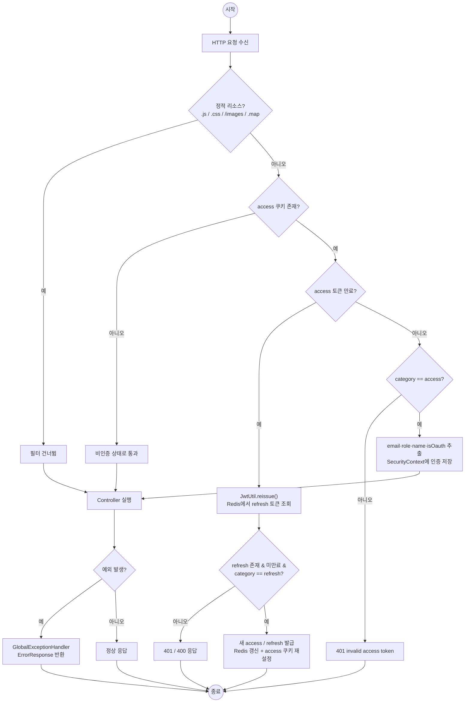

---

## 1. 회원가입 + 이메일 인증

`MemberAPIController`, `MailAPIController`, `mail/service/MailService.java`, `member/service/MemberManagementService.java`

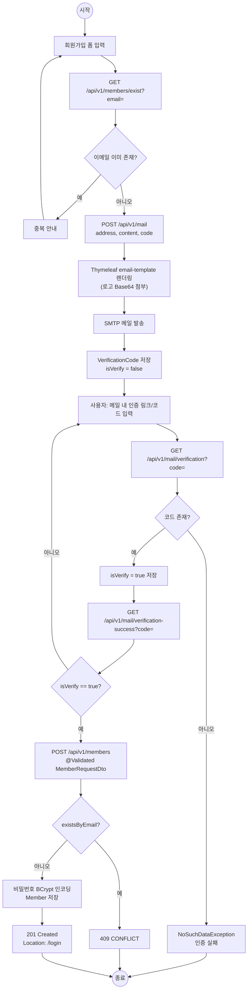

---

## 2. 로그인 / 로그아웃

`security/LoginFilter.java`, `security/oauth2/OAuth2LoginSuccessHandler.java`, `security/oauth2/CustomOAuth2UserService.java`, `security/CustomLogoutFilter.java`

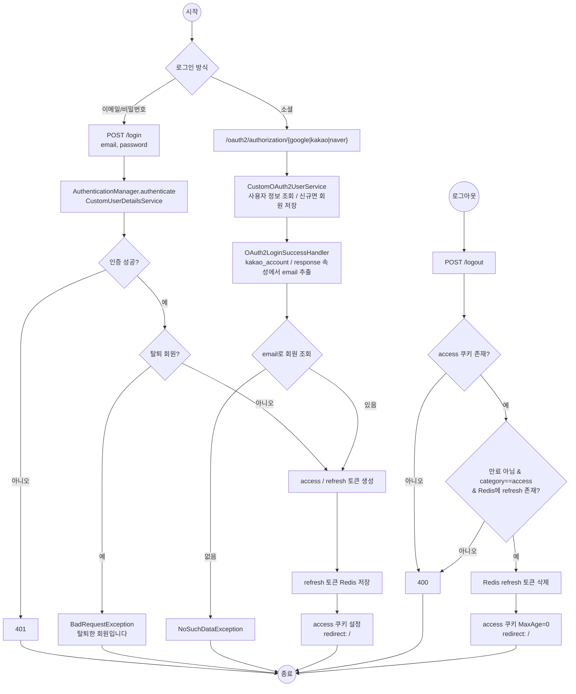

---

## 3. 회원 정보 관리

`MemberAPIController`, `member/service/MemberService.java` → `MemberManagementService` / `MemberRetrieveService`

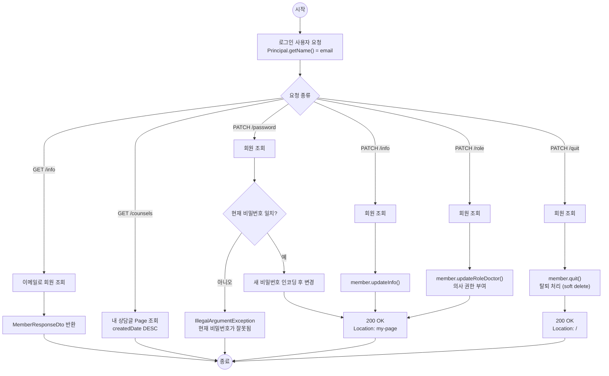

---

## 4. 상담 게시글 (Counsel)

`CounselAPIController`, `counsel/service/CounselManagementService.java`, `CounselRetrieveService.java`

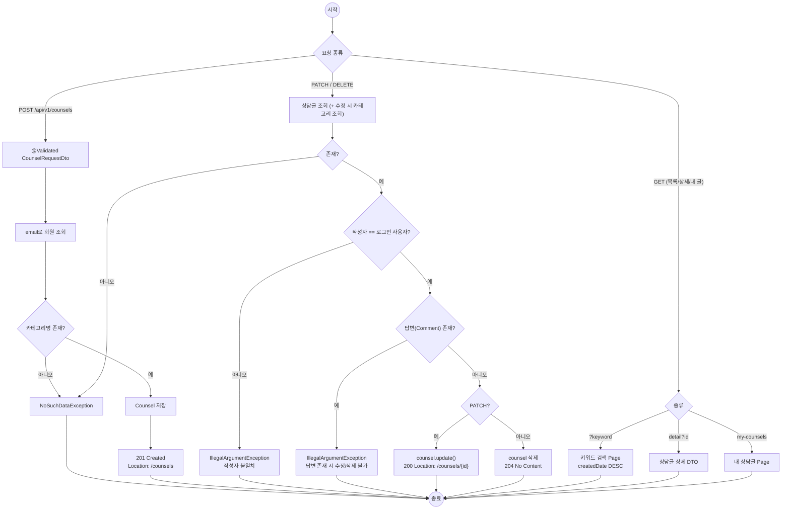

---

## 5. 답변 (Comment)

`CommentAPIController`, `comment/service/CommentManagementService.java`, `CommentRetrieveService.java`

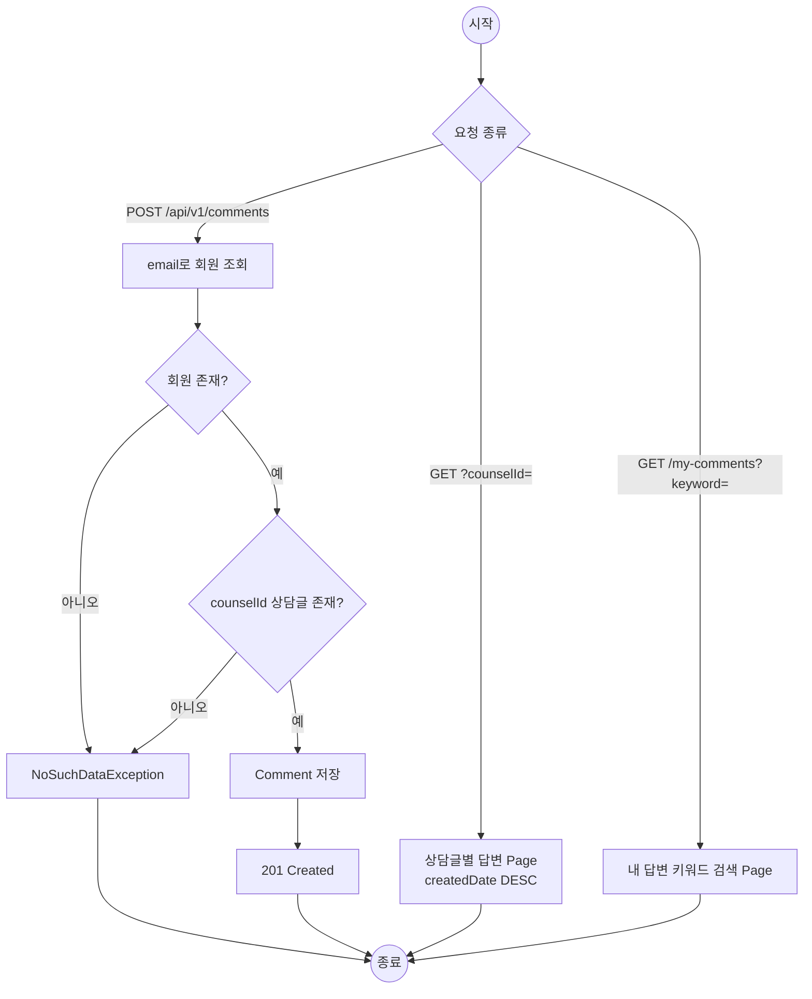

---

## 6. 병원 검색

`hospital/controller/HospitalSearchController.java`, `hospital/service/HospitalSearchService.java`, `hospital/repository/HospitalQueryRepository.java`

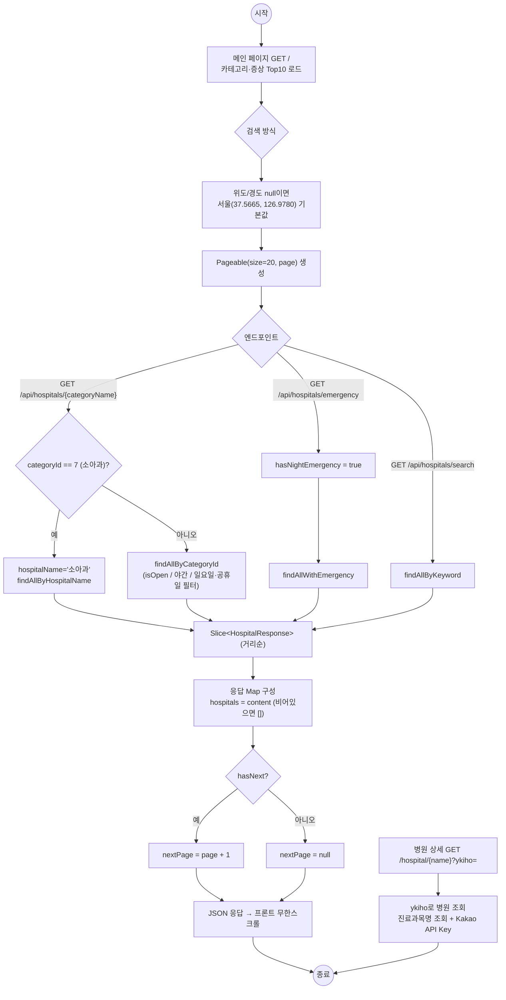

---

## 7. 채팅방 연결 / 조회 / 나가기

`chat/controller/ChatAPIController.java`, `chat/service/ChatService.java`

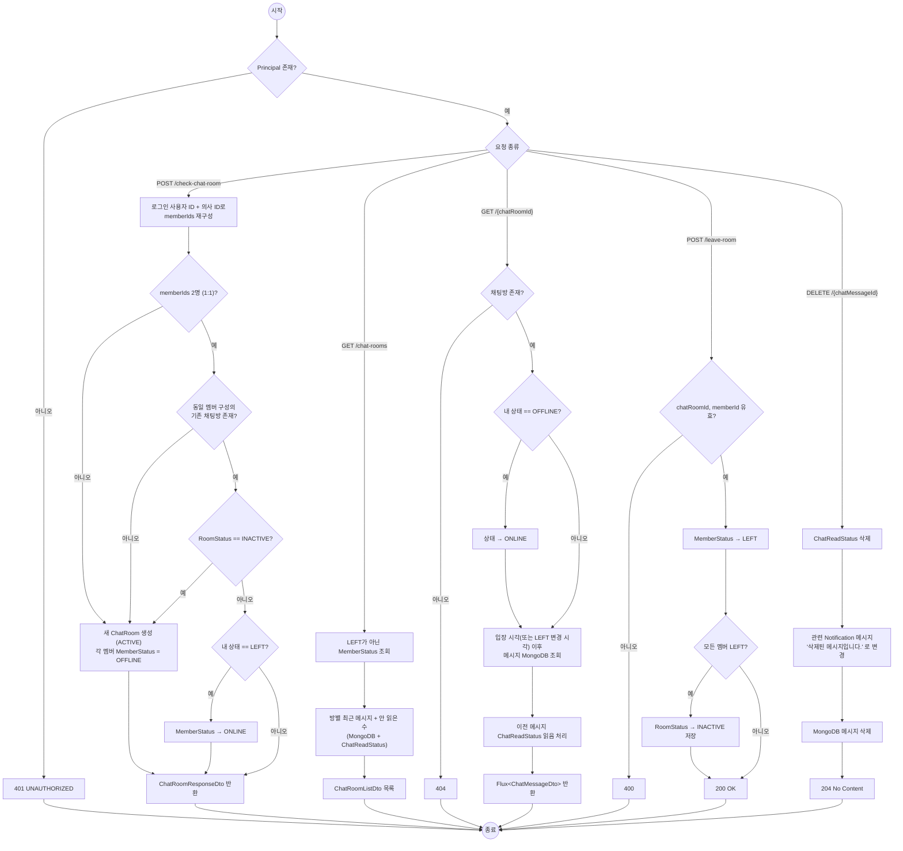

---

## 8. 실시간 채팅 메시지 + 알림 파이프라인

`ChatAPIController#sendMessageToChatRoom`, `ChatService#sendMessageToKafka`, `chat/service/KafkaProducer.java`, `chat/service/KafkaConsumer.java`, `notification/service/NotificationService.java`, `chat/config/WebSocketEventListener.java`

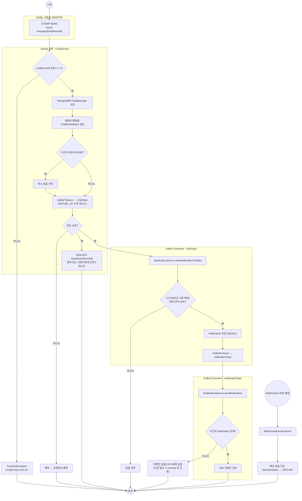

---

## 9. 알림 API

`notification/controller/NotificationAPIController.java`, `notification/service/NotificationService.java`

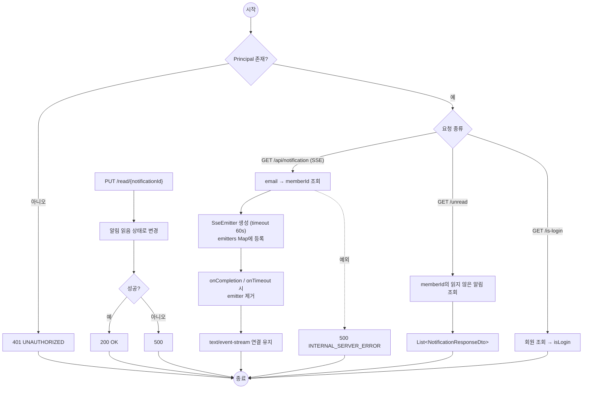

---

## 10. 기타 (면허 암호화, 배치)

`license/controller/LicenseAPIController.java`, `license/util/AES256Util.java`, `hospital/controller/TestController.java`, `hospital/batch/config/HospitalBatchJobConfig.java`

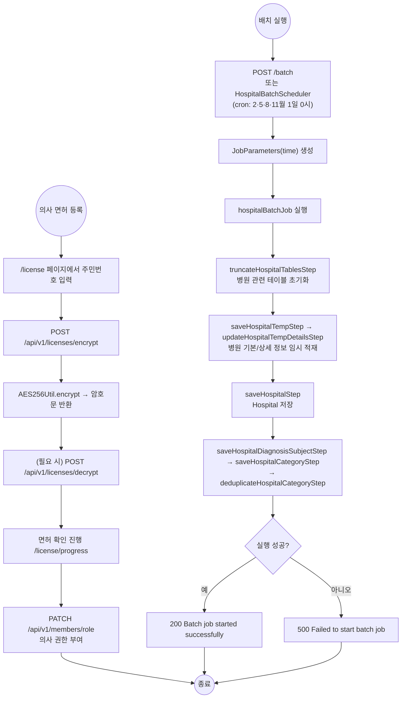
