# sparta_logitics 활동 다이어그램 (API 분석 기반)

> 분석 대상: `sparta_logitics/` (Java 17, Spring Boot 3.5.7, Spring Cloud 2025.0.0)
> 다이어그램은 **현재 코드가 실제로 동작하는 방식**을 기준으로 그렸습니다. 설계 의도와 구현이 어긋나는 곳은 `⚠` 노드와 점선으로 표시했고, 문서 끝 [구현 갭](#10-구현-갭-정리)에 따로 모았습니다.

## 서비스 개요

| 모듈 | 포트 | 역할 |
|---|---|---|
| common | - | `BaseEntity`, `BusinessException`/`ErrorCode`, `UserRoleEnum {MASTER, HUB_MANAGER, DELIVERY_MANAGER, SUPPLIER_MANAGER}` |
| eureka-server | 8761 | 서비스 디스커버리 |
| config-server | 8888 | Native config (`config-server/src/main/resources/config-repo/*-local.yml`) |
| api-gateway | 8000 | 라우팅 + JWT GlobalFilter → `X-USERID`, `X-USERNAME`, `X-USER-ROLE` 주입 |
| auth-service | - | 로그인, JWT 발급 (Feign → user-service) |
| user-service | 9006 | 사용자 CRUD, 승인, 역할 |
| hub-service | - | 허브, 허브 연결, 최단 경로(Dijkstra), Redis 캐시 |
| company-service | - | 업체 CRUD |
| product-service | - | 상품 CRUD (Feign으로 업체·허브 검증) |
| order-service | 9001 | 주문, 클레임, RabbitMQ 발행/구독, Redis 캐시 |
| delivery-service | 8088 | 배송과 구간(route leg) 상태 머신, Feign(hub, ai), RabbitMQ 발행 |
| ai-service | - | 애플리케이션 클래스만 있음 (엔드포인트 없음) |

### 주요 API 요약

| 서비스 | 엔드포인트 |
|---|---|
| auth | `POST /v1/auth/login` |
| user | `POST /v1/users`, `PATCH /v1/users/{id}`, `DELETE /v1/users/{id}`, `PATCH /v1/users/{id}/status`, `PATCH /v1/users/{id}/role`, `GET /v1/users`, `GET /v1/internal/users/by-username` |
| hub | `POST/GET /hubs`, `GET/PUT/DELETE /hubs/{id}`, `GET /hubs/search`, `GET/POST /hub-connections`, `GET/PUT/DELETE /hub-connections/{id}`, `GET /hub-routes` |
| company | `GET/POST /companies`, `GET/PUT/DELETE /companies/{id}` |
| product | `GET/POST /products`, `GET/PUT/DELETE /products/{id}` |
| order | `POST/GET /v1/orders`, `GET/PUT/DELETE /v1/orders/{id}`, `POST/GET /v1/orders/{orderId}/claim` |
| delivery | `POST /v1/delivery/deliveries`, `PUT .../deliveries/{id}/assign-company-driver·start-company-delivery·complete-delivery`, `PUT /v1/delivery/delivery-routes/{routeHistoryId}/assign-driver·start·complete` |

### 전체 흐름 한눈에 보기

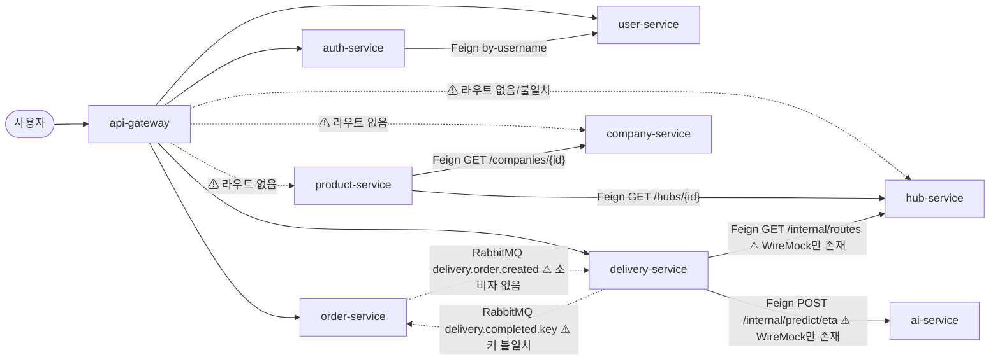

---

## 1. Gateway JWT 필터 (`JwtAuthenticationFilter`)

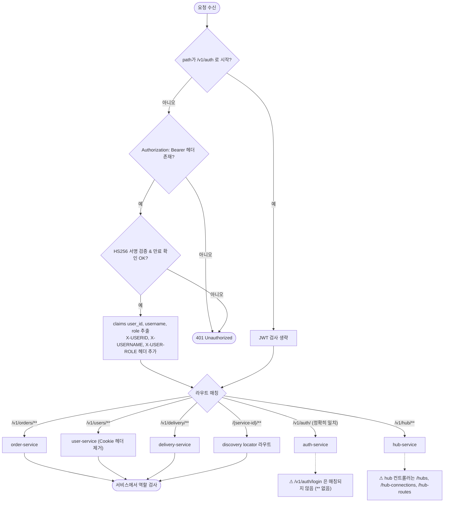

> 게이트웨이는 역할 검사를 하지 않습니다. 각 서비스가 `X-USER-ROLE` 헤더 값으로 `if` 분기를 해서 검사합니다.

---

## 2. 로그인 (auth-service `AuthServiceV1`)

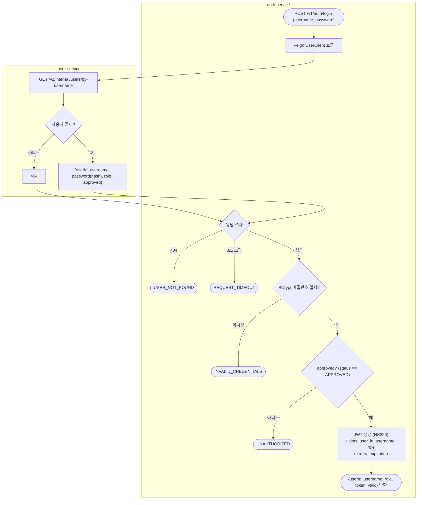

---

## 3. 사용자 관리 (user-service `UserServiceV1`)

자체 회원가입은 없습니다. MASTER가 사용자를 만들고, MASTER나 HUB_MANAGER가 승인합니다.

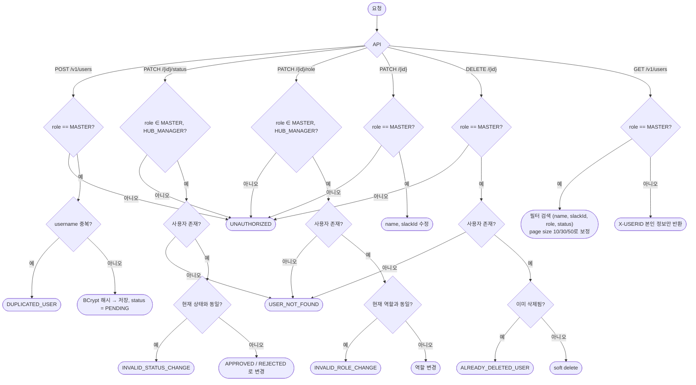

---

## 4. 허브 / 허브 연결 / 최단 경로 (hub-service)

### 4-1. 허브 · 연결 CRUD

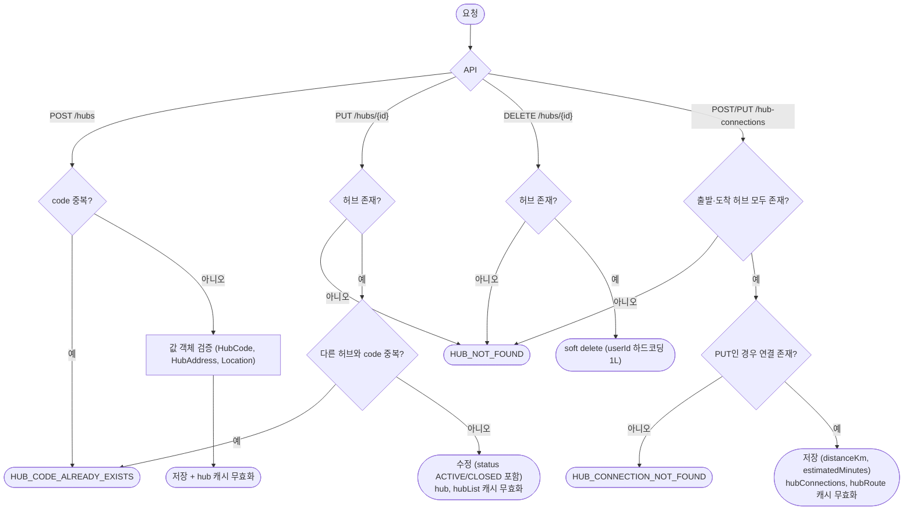

### 4-2. 최단 경로 조회 `GET /hub-routes?departureHubId&arrivalHubId`

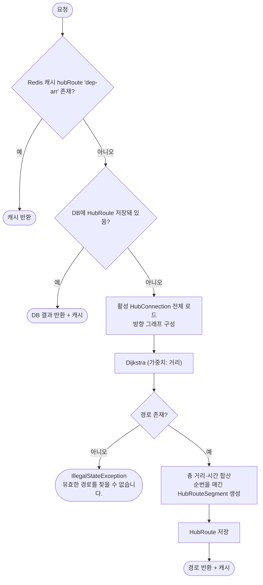

---

## 5. 업체 관리 (company-service `CompanyService`)

필수 헤더는 `X-User-Id`, `X-Username`, `X-User-Role`입니다. 역할 검사는 구현되어 있지 않습니다.

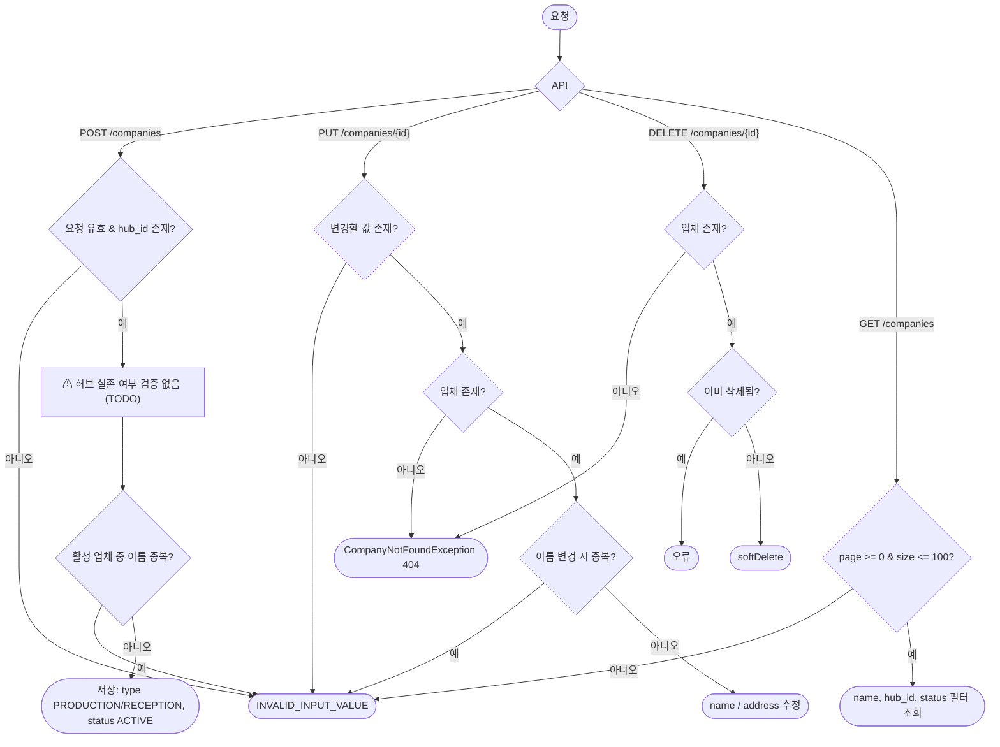

---

## 6. 상품 등록 (product-service `ProductService`)

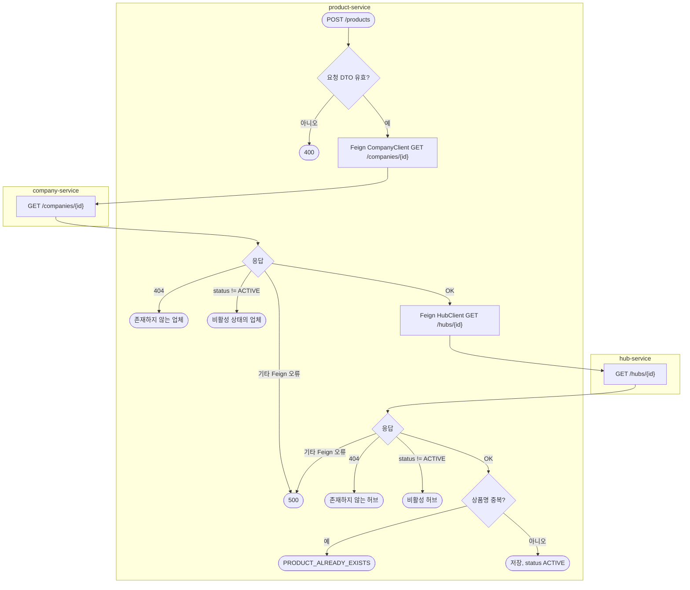

> 수정(`PUT`)도 이름 중복을 똑같이 확인합니다. 삭제(`DELETE`)는 status를 `INACTIVE`로 바꿉니다.

---

## 7. 주문 (order-service)

### 7-1. 주문 생성 · 조회 · 수정 · 삭제

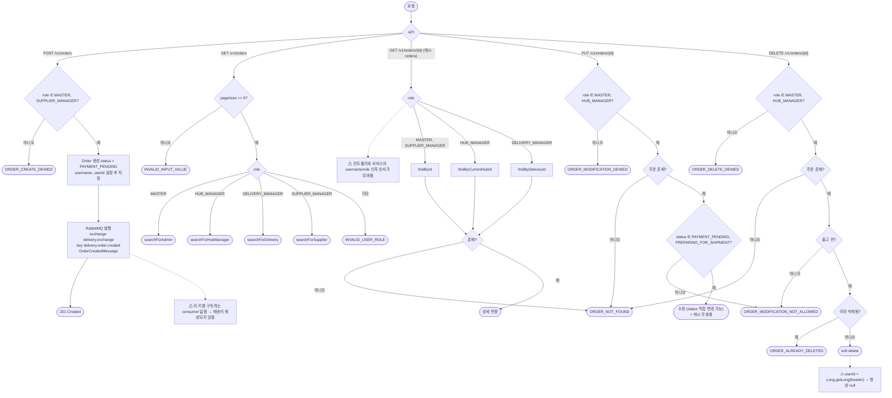

### 7-2. 클레임 · 이벤트 리스너

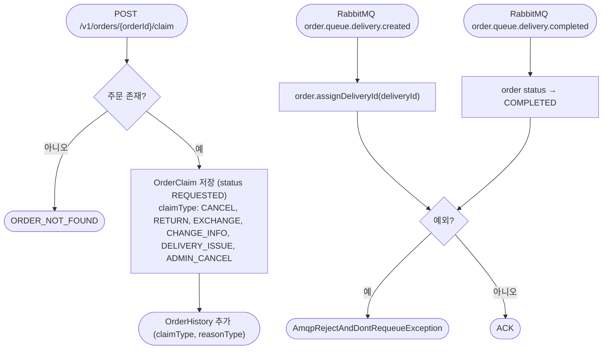

**주문 상태:** `PAYMENT_PENDING → PREPARING_FOR_SHIPMENT → SHIPPED → DELIVERED → COMPLETED` (그 밖에 `CANCELED`, `FAIL`, `RETURNED`)

---

## 8. 배송 생성 및 진행 (delivery-service)

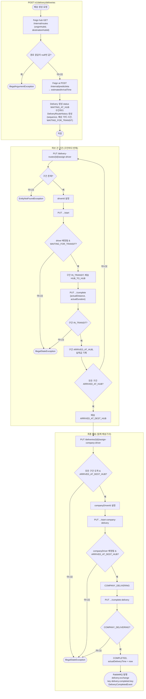

**배송 상태:** `WAITING_AT_HUB → HUB_TO_HUB → ARRIVED_AT_DEST_HUB → COMPANY_DELIVERING → COMPLETED` (`FAILED`는 정의돼 있지만 설정하는 코드가 없음)
**구간 상태:** `WAITING_FOR_TRANSIT → IN_TRANSIT → ARRIVED_AT_HUB`

---

## 9. 주문 → 배송 연계 (의도 vs 실제)

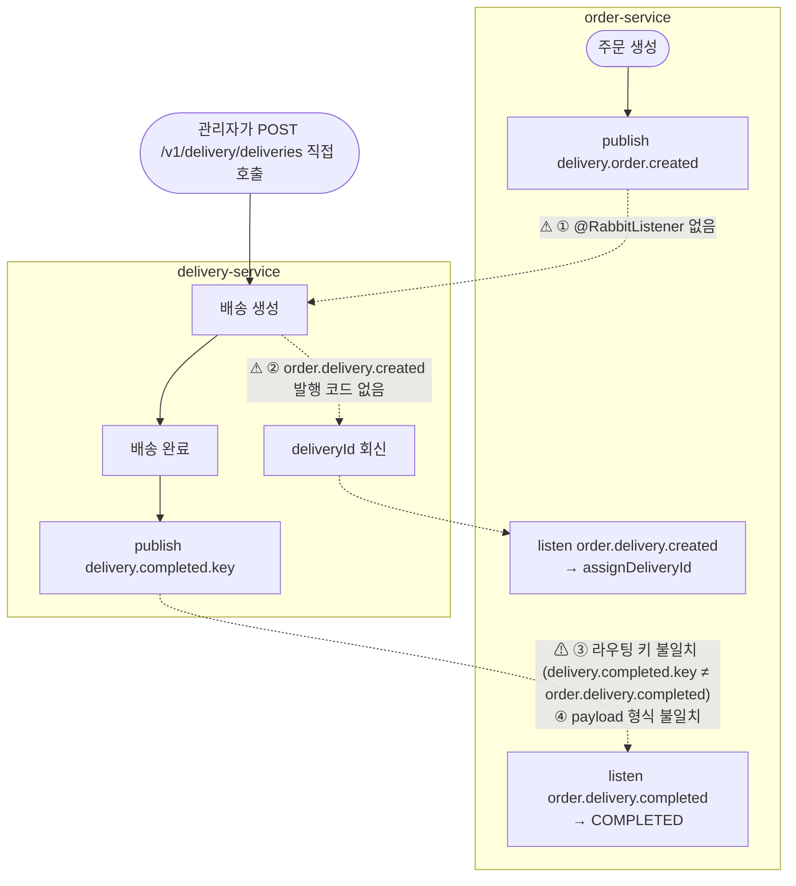

> 지금은 주문을 만들어도 배송이 자동으로 생기지 않습니다. 배송은 API를 직접 호출해야 만들어지고, 배송이 끝나도 주문 상태는 `COMPLETED`로 바뀌지 않습니다.

---

## 10. 구현 갭 정리

| # | 위치 | 내용 | 영향 |
|---|---|---|---|
| 1 | gateway `api-gateway-local.yml` | auth 라우트가 `/v1/auth/`(정확히 일치)라서 `/v1/auth/login`이 매칭되지 않음 | 게이트웨이를 통한 로그인 불가 (discovery 경로로만 가능) |
| 2 | gateway | hub 라우트 `/v1/hub/**`가 실제 경로 `/hubs`, `/hub-connections`, `/hub-routes`와 다름 | hub API 라우팅 불가 |
| 3 | gateway | company-service, product-service 라우트 없음 | discovery 경로로만 접근 가능 |
| 4 | gateway ↔ company/product | 게이트웨이는 `X-USERID`/`X-USERNAME`을 넣지만, 두 서비스는 `X-User-Id`/`X-Username`을 요구함 | 필수 헤더 누락으로 400 |
| 5 | company/product | 역할 검사 없음, 업체 생성 시 허브 존재 검증 없음 | 권한 없는 사용자도 등록 가능 |
| 6 | hub-service | 인증·역할 검사 없음, 삭제 시 `userId = 1L` 하드코딩 | 감사 정보 부정확 |
| 7 | order `OrderController.getOrderDetail` | `(id, username, userRole)`를 `(id, userRole, username)` 시그니처에 전달 | 역할 분기가 username 값으로 평가됨 |
| 8 | order `delete` | `Long.getLong(header)` 사용 (시스템 프로퍼티를 읽음) | deletedBy가 항상 null |
| 9 | order → delivery | `delivery.order.created` consumer 없음, `order.delivery.created` 발행 없음 | 주문해도 배송이 생성되지 않고 deliveryId도 연결되지 않음 |
| 10 | delivery → order | 라우팅 키 `delivery.completed.key`와 `order.delivery.completed` 불일치, payload도 다름 | 배송 완료가 주문에 반영되지 않음 |
| 11 | delivery → hub/ai | `/internal/routes`, `/internal/predict/eta`는 WireMock에만 있음 (실제 hub는 `/hub-routes`, ai-service는 빈 모듈) | 실제 서비스로 배포하면 배송 생성 실패 |
| 12 | order Feign | `DeliveryApiClient`(미사용, 대상 엔드포인트 없음), `HubApiClient`(빈 인터페이스) | 죽은 코드 |
| 13 | delivery-service | `getDeliveryDetails`, `searchDeliveries`, `deleteDelivery`가 엔드포인트로 노출되지 않음 | 배송 조회 API 없음 |
| 14 | 전반 | Slack 알림 미구현 (`slackId`, `recipientSlackId`는 저장만 함), AI 서비스 미구현 | - |
